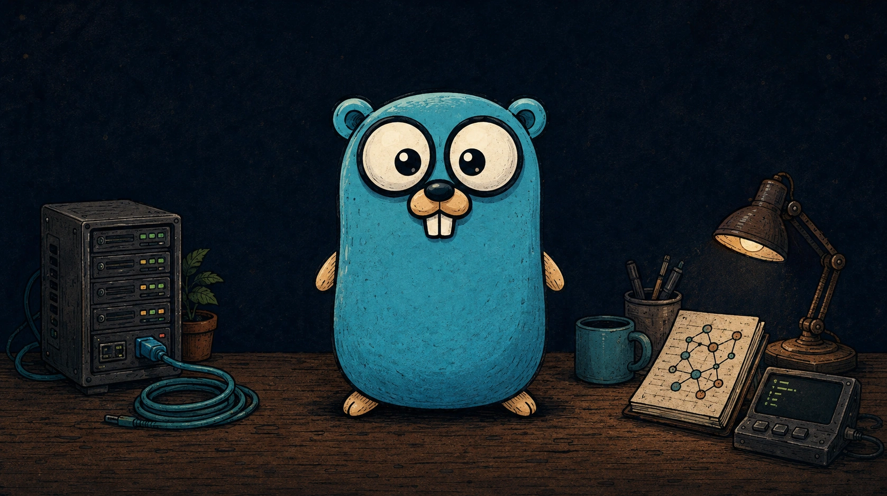
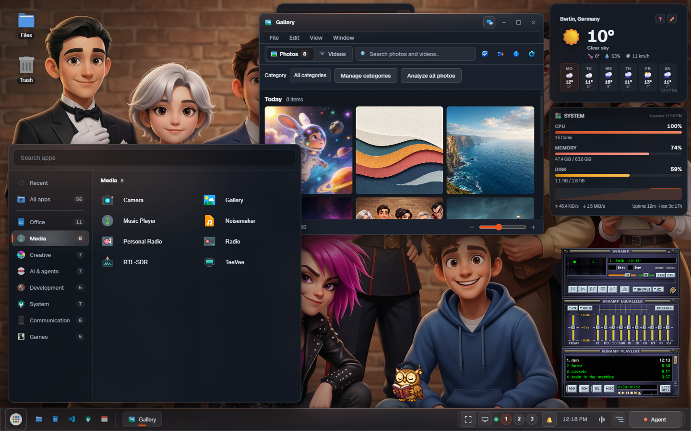
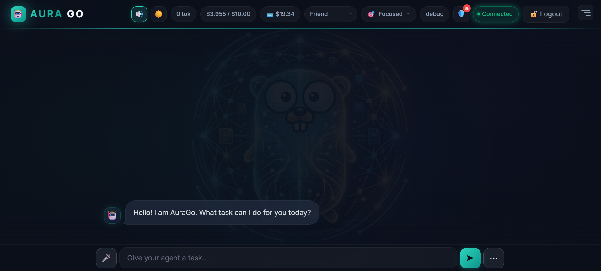
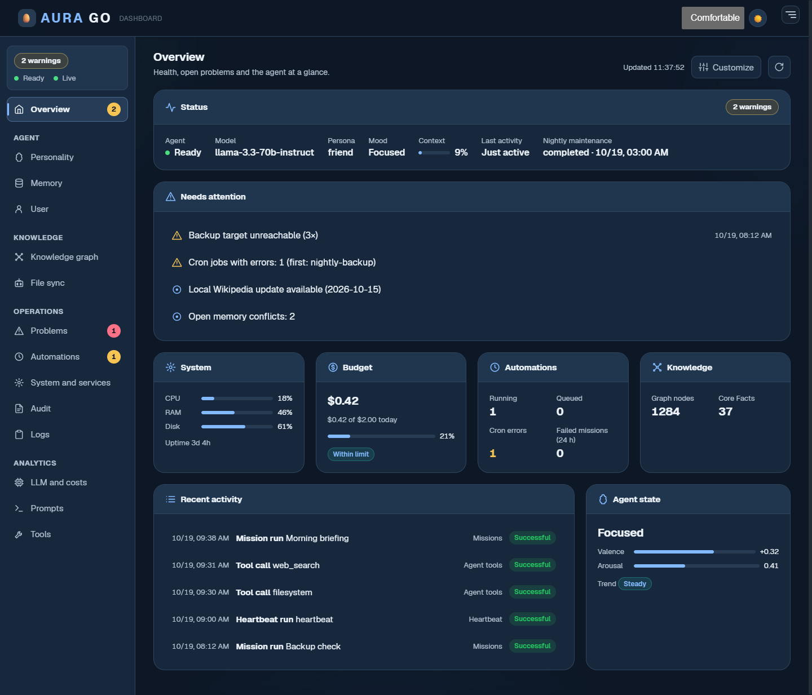
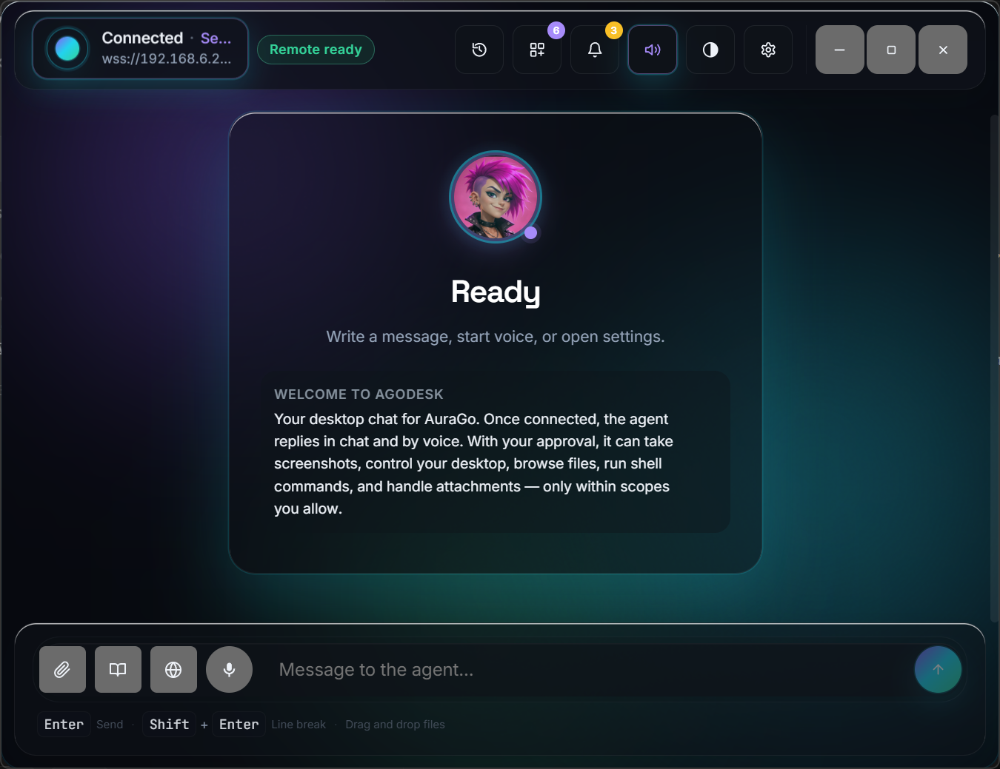
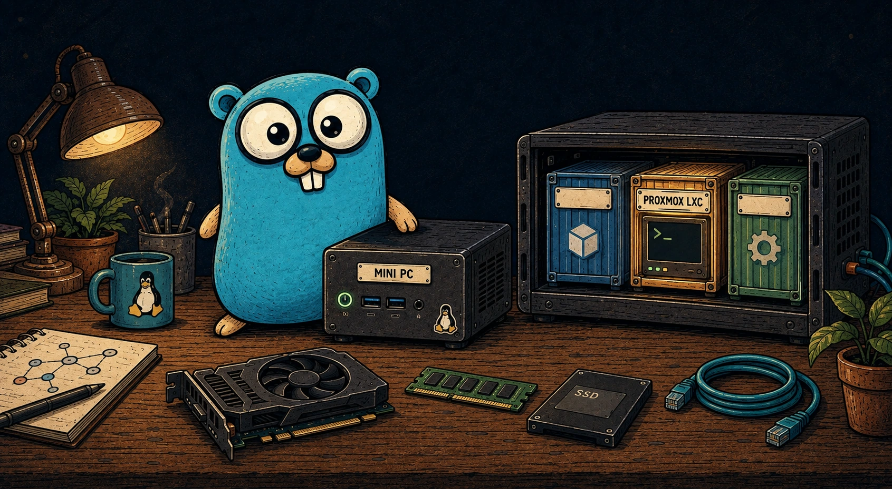

<p align="center">
  <a href="assets/readme/gopher-masthead.webp"></a>
</p>

<h1 align="center">AuraGo</h1>

<p align="center"><strong>One gopher. A ridiculous toolbox.</strong></p>

<p align="center">
  <a href="https://github.com/antibyte/AuraGo/releases/latest"></a>
  <a href="LICENSE"></a>
  
  
  
</p>

Your self-hosted AI agent can SSH into your NAS, talk over mesh radio, build a browser game and remember what you were doing yesterday. It has a web desktop, a personality, helper agents and a growing pile of integrations. Written in Go: one binary, a matching locally served UI bundle and embedded SQLite databases next to it. Bring a local or hosted model. Pick the toys you want to connect.

<p align="center">
  <a href="#the-toy-box">Features</a> · <a href="#fresh-from-the-workbench">What's new</a> · <a href="#studios-make-things">Studios</a> · <a href="#yes-there-is-an-arcade-too">Arcade</a> · <a href="#under-the-hood">How it connects</a> · <a href="#what-do-i-need-to-run-it">Requirements</a> · <a href="#quick-start">Install</a> · <a href="documentation/manuals/en/README.md">English manual</a> · <a href="documentation/manuals/de/README.md">Deutsches Handbuch</a>
</p>

[](assets/readme/gopher-feature-map.webp)

## Fresh from the workbench

*October 2026*

- **Video Studio.** A multitrack editor with keyframes, speed ramps, `.cube` LUTs, masks, chroma key, a WebGL2 preview and a project manager with versions. FFmpeg export, with optional GPU encoding. Off by default. [Guide](documentation/video-studio.md)
- **Dashboard redesign.** A sidebar with 14 sections, customizable overview tiles, a summary feed and attention badges. [Chapter 13](documentation/manuals/en/13-dashboard.md)
- **Bookshelf and Mailer.** A reader for EPUB, MOBI/KF8, FB2, CBZ, TXT and PDF, plus a mail client with background sync. [Bookshelf](documentation/bookshelf.md) · [Mailer](documentation/mailer.md)
- **Galaxa Deluxe and AuraGolf.** A synthwave arcade shooter with 50 animated motifs, and 18 low-poly 3D minigolf holes for up to four players on one device. [Galaxa](documentation/galaxa-expansion.md) · [AuraGolf](documentation/minigolf.md)
- **Synth Studio.** Five banks of ten presets, a General MIDI bank of 128 synthesized sounds, a piano roll and Web MIDI input. [Guide](documentation/synth-studio.md)
- **Infra atlas.** A homelab map with topology, inventory and live power, on by default. [Guide](documentation/infra.md)
- **Retro-Net and Retro Games.** The Terminal dials Telnet and SSH BBSes, C64 boards and MUDs. Retro Games plays about 72,500 archive.org titles, with a 46-game Hall of Fame. [Retro-Net](documentation/retro-net.md) · [Retro Games](documentation/retro-games.md)
- **Local Wikipedia.** Whole Wikipedia editions for offline search and reading, in pure Go. [Guide](documentation/local-wikipedia.md)
- **Camera person detection.** Per-camera person detection for go2rtc cameras, with zones, photo alerts and flow or mission triggers. [Guide](documentation/go2rtc.md)
- **EasyDrag flows.** A visual flow editor where flows run as missions, with version history and auto-layout. [Chapter 24](documentation/manuals/en/24-easydrag.md)
- **Memory insights.** Insights keep their evidence and revisions, and memory corrections let you fix what the agent got wrong. [Insights](documentation/learnings.md) · [Corrections](documentation/memory-corrections.md)

[Full release notes on GitHub](https://github.com/antibyte/AuraGo/releases)

## The toy box

- **Your home lab, on speaking terms.** Docker, Proxmox VMs and LXCs, TrueNAS, Home Assistant, MQTT, Fritz!Box, AdGuard, Tailscale, SSH and Wake-on-LAN. Inspect services, work with files, switch things on. The **Infra** atlas draws the map: topology, inventory and live power.
- **A desktop with side quests.** Agent chat, files, terminal, gallery, calendar, radio and a Winamp-style music player. Code Studio for code, Homepage Studio for websites, Game Maker for single-player 2D, 3D and voxel browser games, CYD Creator for ESP32 touch-display apps.
- **It remembers.** Conversation history, core facts, local embeddings, document RAG, a knowledge graph, notes and a journal. Insights keep their evidence, and memory corrections let you fix what it got wrong. Personality traits, moods and an inner voice shape how it talks.
- **Put it on autopilot.** Missions, cron schedules and webhooks start recurring work. **EasyDrag** flows run as missions, and **Looper** runs goal loops with a cost budget. Co-agents tackle subtasks. **Invasion Control** hatches worker “Eggs” on remote “Nests” over SSH or Docker. Yes, those are the actual names.
- **Give it a computer.** Agent Workspaces provide disposable Firecracker VMs with a shell, files and a visible Chromium browser. The main agent does the thinking; the VM is its workbench.
- **Give it a voice.** Telegram, Discord, Rocket.Chat, email, realtime speech and SIP telephony. Speech Lab adds local speech recognition and synthesis.
- **MeshCore, over the air.** Trusted direct messages and restricted channel replies over mesh radio.
- **Your own personal newspaper and radio station.** A daily Newspaper tailored to your interests, plus Personal Radio with imported or generated music, an AI host and optional news bulletins.
- **Tune into RTL-SDR.** Live listening, scheduled recordings and optional speech transcription. Needs Linux with a local Docker Engine and an RTL2832/RTL2838 dongle.
- **Wikipedia in your pocket.** Grab a whole Wikipedia edition in one of the UI languages, with or without pictures, and the agent searches and reads it offline. There's a little Wikipedia app on the desktop, too. Pure Go: no container, no extra server.
- **Make things.** Documents, PDFs, images, music, video and websites through configured tools and providers. Connect GitHub, Google Workspace, S3, WebDAV and SQL; play media through Jellyfin or Chromecast.
- **Read, write, keep.** Bookshelf reads EPUB, MOBI/KF8, FB2, CBZ, TXT and PDF from local folders, uploads, WebDAV, Koofr or SMB. Mailer handles IMAP, POP3 and SMTP, Google accounts via gog, and syncs in the background. Writer, Sheets and Notes do the paperwork. Tresor keeps notes and files encrypted in your browser (Argon2id and AES-GCM), with a recovery key.
- **Eyes on the house.** go2rtc cameras with per-camera person detection, zones and alerts that come with photos. Detections can trigger flows and missions.
- **Plug in the weird stuff.** Klipper/Moonraker and Elegoo 3D printers, an **ESP32 Cheap Yellow Display** for a tiny desk dashboard, **RuView** Wi-Fi sensing (experimental, ESP32 hardware), **Layerling** browser CAD, and Linux **Bluetooth** audio with an app to scan, pair and connect. Extend further with Python Skills, Agent Skills and MCP.

[All integrations](documentation/manuals/en/08-integrations.md) · [Tool catalog](documentation/manuals/en/22-internal-tools.md) · [Game Maker](documentation/game-maker-studio.md) · [Video Studio](documentation/video-studio.md) · [Bookshelf](documentation/bookshelf.md) · [Mailer](documentation/mailer.md) · [Detective](documentation/detective.md) · [MeshCore](documentation/meshcore-en.md) · [Agent Workspaces](documentation/virtual_computers.md) · [Local Wikipedia](documentation/local-wikipedia.md) · [Infra](documentation/infra.md) · [Retro-Net](documentation/retro-net.md) · [Retro Games](documentation/retro-games.md) · [CYD Creator](documentation/cyd-creator.md)

### Yes, there is an actual desktop

[](documentation/screenshots/desktop.png)

*Real screenshot. The desktop is experimental. Click any image to inspect it at full size.*

<p align="center"><strong>Around 60 desktop apps · 9 start-menu categories · 3 virtual Spaces · screensavers, animated wallpapers and desktop pets</strong></p>

<details>
<summary>Chat screenshot</summary>

[](documentation/screenshots/chat.png)

</details>

<details>
<summary>Dashboard screenshot</summary>

[](documentation/screenshots/dashboard.png)

*Overview with sample data from a local test instance, dark theme.*

</details>

<details>
<summary>The whole desktop, app by app</summary>

| Start-menu category | What it holds | Apps |
| --- | --- | --- |
| **Office** | Paperwork, reading and the everyday organizer | Writer · Sheets · Editor · Notes · Calendar · Todo · Calculator · People · Cheater · Tresor · Wikipedia · Bookshelf |
| **Media** | Pictures, music, radio and TV | Gallery · Camera · Music Player · Radio · Personal Radio · RTL-SDR · TeeVee · Noisemaker |
| **Creative** | Images, video, music, games, websites and CAD you build | Pixel · Video Studio · Synth Studio · Game Maker Studio · Homepage Studio · Layerling · NASSCAD |
| **AI** | The agent at work: chat, voice, missions, flows, research and news | Agent Chat · Live Speech · Mission Control · Looper · EasyDrag · Detective · Newspaper |
| **Dev** | Code, shells, remote machines and tiny hardware | Code Studio · Terminal · Quick Connect · Virtual Computers · CYD Creator · Log Viewer |
| **System** | The machine, the store and your home lab | Files · Settings · Zipper · Launchpad · Software Store · Infra · System World |
| **Comms** | People, mail, radios and cameras | Phone · Mailer · MeshCore · Network Cameras · Bluetooth · RuView · HA Switchboard |
| **Games** | Short breaks, and the desktop pets | Galaxa Deluxe · AuraGolf · Chess · Retro Games · Pet Picker |
| **Installed** | Managed Docker apps from the Software Store | Homarr · n8n · Node-RED · Open WebUI · code-server · Dozzle · God's Eye View and more |

</details>

### Studios: make things

Tools for making things, from code to CAD.

| Studio | What it does | Docs |
| --- | --- | --- |
| **Code Studio** | Container-backed IDE with tty terminals, project insights and a multi-language code graph | [Virtual Desktop](documentation/manuals/en/04-webui.md#virtual-desktop) |
| **Video Studio** | Multitrack editor with keyframes, LUTs, masks, chroma key, a WebGL2 preview and FFmpeg export. Off by default | [Guide](documentation/video-studio.md) |
| **Synth Studio** | Five banks of ten presets, a General MIDI bank of 128 sounds, a piano roll and Web MIDI input | [Guide](documentation/synth-studio.md) |
| **Noisemaker** | AI music studio with a library and player. Local ACE-Step is optional | [ACE-Step](documentation/ace-step-local.md) |
| **Pixel** | Image editor with filters, crop, resize and optional AI generation | [Virtual Desktop](documentation/manuals/en/04-webui.md#virtual-desktop) |
| **Game Maker** | Single-player 2D, 3D and voxel browser games with a sprite library | [2D/3D](documentation/game-maker-studio.md) · [Voxel](documentation/game-maker-voxel.md) |
| **Homepage Studio** | Build, validate and deploy managed website projects | [Virtual Desktop](documentation/manuals/en/04-webui.md#virtual-desktop) |
| **CYD Creator** | Touch-display apps for ESP32 boards: 60-motif icon library, LVGL animations, serial flasher and OTA | [Guide](documentation/cyd-creator.md) |
| **Layerling** | Local browser CAD for STL, OBJ, 3MF, STEP and SVG files | [Guide](documentation/layerling.md) |
| **EasyDrag** | Visual flow editor. Flows run as missions | [Chapter 24](documentation/manuals/en/24-easydrag.md) |
| **Writer** | Native DOCX word processor | [Guide](documentation/autor.md) |

### Yes, there is an arcade too

Take a break. The desktop comes with a small arcade, a chess board and a few places to wander around in. None of it is required for the serious work.

- **Galaxa Deluxe.** Arcade shooter with 50 animated motifs, weapon evolutions, alien attack patterns and a synthwave soundtrack. [Guide](documentation/galaxa-expansion.md)
- **AuraGolf.** 18 low-poly 3D minigolf holes for 1–4 players on one device. [Guide](documentation/minigolf.md)
- **Chess.** Play against an agent opponent.
- **Retro Games.** An archive.org player with about 72,500 titles, a 46-game Hall of Fame and favorites. [Guide](documentation/retro-games.md)
- **Retro-Net.** The Terminal dials public Telnet and SSH BBSes, C64 boards and MUDs. On by default; every connection runs through the AuraGo server. [Guide](documentation/retro-net.md)
- **System World.** An explorable 3D city. [Guide](documentation/system-world-2.md)
- **NASSCAD.** A docking game.

### AgoDesk — your agent, right on your desktop

Prefer a desktop app? **AgoDesk for Windows and Linux** brings AuraGo to your machine: chat, voice conversations, drag-and-drop attachments and uploads to AuraGo's knowledge archive. Enable **computer and browser use** to let your agent work with local apps, web pages and files within the access you approve. Your favorite persona comes along, too.

<p align="center">
  <a href="assets/readme/agodesk.png"></a>
</p>

**[Get AgoDesk for Windows and Linux](https://github.com/antibyte/agodesk)** · [Downloads](https://github.com/antibyte/agodesk/releases)

## Choose your agent

**Many personalities. One goal: get your stuff done.**

[](assets/readme/persona-party.webp)

AuraGo comes with **twelve personalities**: a friendly sidekick, a thoughtful philosopher, a punk or a wonderfully overdramatic villain. Pick your company in **Config → Personality**. Same toolbox, different attitude. [Meet the personalities](documentation/manuals/en/10-personality.md).

**AuraGo is fully translated to many languages.**

[](assets/readme/language-flags.webp)

## Pick your path

| I want to… | Start here |
| --- | --- |
| run it in ten minutes | [Quick start](#quick-start) |
| connect my home lab | [Integrations](documentation/manuals/en/08-integrations.md) |
| cut a video | [Video Studio](documentation/video-studio.md) |
| put the agent on autopilot | [Missions](documentation/manuals/en/11-missions.md) and [EasyDrag flows](documentation/manuals/en/24-easydrag.md) |
| keep it offline | [Local models](documentation/local_llm_aurago_qwen.md) and [Local Wikipedia](documentation/local-wikipedia.md) |
| lock it down | [Security introduction](documentation/security_introduction.md) and [Security chapter](documentation/manuals/en/14-security.md) |
| talk to it from my phone | [Telegram setup](documentation/telegram_setup.md) · [more channels](documentation/manuals/en/08-integrations.md) |
| build a tiny desk gadget | [CYD Creator](documentation/cyd-creator.md) |

## Under the hood

[](documentation/architecture.md)

The **Go backend** serves the API and a verified, version-bound local web bundle. SQLite and the vector store persist locally; integrations and optional runtimes keep their own permissions. [Architecture guide](documentation/architecture.md).

Messages and mission triggers reach the **agent loop**. It builds context, calls your chosen model, runs allowed tools and reads the results before the next round. **Co-agents** return subtask results. Service clients use the **vault** for credentials; optional sidecars provide things like local inference, speech and browser workspaces.

Optional layers sit on top. The **LLM router** sends tasks to different models per area (off by default). The **Decisions** service classifies ambiguous tasks (also off by default). **Looper** runs goal loops with a cost budget priced per model.

**Personality changes the tone, not the permissions.** Integrations, channels and workers keep their own access rules. Shell, Python, writes, network access and remote execution have separate Danger Zone gates; Guardian adds checks. Enable what you need.

### The gopher has more than one memory drawer

[](assets/readme/gopher-memory-map.webp)

**History** keeps recent turns; **Core Memory** keeps important facts; **RAG** finds related documents and memories; the **knowledge graph** connects entities and relationships. **Insights** keep what the agent learned, with the evidence behind each one and its revisions, and **memory corrections** let you fix what it got wrong. Relevant pieces go into the next request. Recall tools can fetch more. The illustrations simplify the system; they are not UI screenshots.

[Memory deep dive](documentation/manuals/en/09-memory.md) · [Insights](documentation/learnings.md) · [Memory corrections](documentation/memory-corrections.md) · [Architecture](documentation/architecture.md) · [Co-agents](documentation/manuals/en/15-coagents.md) · [Eggs and Nests](documentation/manuals/en/12-invasion.md) · [Desktop themes](documentation/desktop-themes.md)

## What do I need to run it?

**A Linux box and a little room for a gopher.** A Debian-based distribution is ideal. A small **Ryzen 5 or Ryzen 7 mini PC**, or a **Proxmox LXC container**, makes a great home for AuraGo.

[](assets/readme/gopher-hardware.webp)

| Minimum | Recommended |
| --- | --- |
| Dual-core CPU | Quad-core CPU |
| 2 GB RAM | 8 GB RAM |
| 1 GB free storage | 20+ GB SSD |

**Integrated and dedicated GPUs are supported for local LLMs and text-to-speech (TTS)** with compatible hardware and backends. The specs above cover AuraGo itself; local models and optional services need extra RAM, storage and, where applicable, GPU memory. Video Studio exports can use hardware encoding (VAAPI, QSV, NVENC, AMF) when present.

## Quick start

> [!WARNING]
> **Still a work in progress.** One maintainer, uneven test coverage, occasional rough edges. Linux comes first; Windows and macOS builds are less tested. Features depend on permissions, providers, hardware and sometimes Docker or extra downloads.

### Linux

**Install (no Go or Cosign setup).** Download the official installer over HTTPS. It automatically checks the release signature and all downloaded application files:

```bash
curl -fsSLO https://github.com/antibyte/AuraGo/releases/latest/download/install.sh
bash install.sh
```

**Quick install (runs the script from the main branch):**

```bash
curl -fsSL https://raw.githubusercontent.com/antibyte/AuraGo/main/install.sh | bash
```

The installer starts AuraGo and prints your URL and first-login password. Open that address (usually **http://localhost:8088** on the host), change the password, and finish `/setup`. Pick a model, connect an integration, then try **“Show me system information.”**

Updates from the app, agent or `update.sh` use the same automatic signature checks.
No public-key files or environment variables are required. Operators migrating a
blocked older updater can use the [verified repair procedure](documentation/release-signatures.md#existing-installations).

<details>
<summary>Docker instead?</summary>

```bash
git clone https://github.com/antibyte/AuraGo.git
cd AuraGo
docker compose up -d
```

Open **http://localhost:8088**. The stack uses persistent volumes and a restricted Docker socket proxy; it creates a vault key if none is supplied. Back up the data and key. [Docker guide](documentation/docker_installation.md).

</details>

<details>
<summary>Build it yourself — Go 1.27.3+</summary>

```bash
git clone https://github.com/antibyte/AuraGo.git
cd AuraGo
node scripts/build-ui-bundles.js
go run ./cmd/assetpack -out deploy -stage assets/web
go build -trimpath -ldflags="-s -w $(cat deploy/web-assets.ldflags)" -o aurago ./cmd/aurago
./aurago --check-assets
```

The PowerShell variant lives in [documentation/web-assets.md](documentation/web-assets.md).

Copy `config_template.yaml` to `config.yaml`. Set a persistent, random 64-character hexadecimal `AURAGO_MASTER_KEY` in your environment or a protected `.env` before running `./aurago`. Keep the key with your backups. [Configuration](documentation/configuration.md).

</details>

> [!IMPORTANT]
> Your data is stored with your installation. **Hosted models and external services still receive their request inputs.** Self-hosted does not automatically mean offline. Use login, HTTPS and optional 2FA for internet-facing access; read the [security guide](documentation/security_introduction.md).

## More rabbit holes

[English manual](documentation/manuals/en/README.md) · [Deutsches Handbuch](documentation/manuals/de/README.md) · [Local models](documentation/local_llm_aurago_qwen.md) · [Speech Lab](documentation/s2s_speech_lab.md) · [SIP](documentation/sip_telephony.md) · [Skills](documentation/manuals/en/19-skills.md) · [API](documentation/manuals/en/21-api-reference.md) · [Troubleshooting](documentation/manuals/en/16-troubleshooting.md) · [Release notes](documentation/release-notes-2026-10-runtime-fixes.md)

[Video Studio](documentation/video-studio.md) · [Synth Studio](documentation/synth-studio.md) · [Bookshelf](documentation/bookshelf.md) · [Mailer](documentation/mailer.md) · [Infra](documentation/infra.md) · [RuView](documentation/ruview.md) · [Decisions](documentation/decisions.md) · [LLM router](documentation/llm-router.md) · [Retro-Net](documentation/retro-net.md) · [Retro Games](documentation/retro-games.md) · [Layerling](documentation/layerling.md) · [Tresor](documentation/tresor.md) · [Detective](documentation/detective.md)

[Releases](https://github.com/antibyte/AuraGo/releases) · [Website](https://antibyte.github.io/aurago-web/) · [AgoDesk for Windows and Linux](https://github.com/antibyte/agodesk)

The executable contains a small recovery/login page. The full UI is a matching,
locally served resource set included by the installer and Docker image.
[Resource packaging and offline installation](documentation/web-assets.md).

Want to tinker? Start with [AGENTS.md](AGENTS.md), follow the build steps above, and test with `go test ./...`.

**[MIT licensed](LICENSE).** Have fun. Mind the permissions.

*The illustrations are hand-inked-style renders. Prompts and provenance are in [assets/readme/imagegen-prompts.md](assets/readme/imagegen-prompts.md).*

<p align="center"><em>Made in Go by one maintainer and a turquoise gopher.</em></p>
