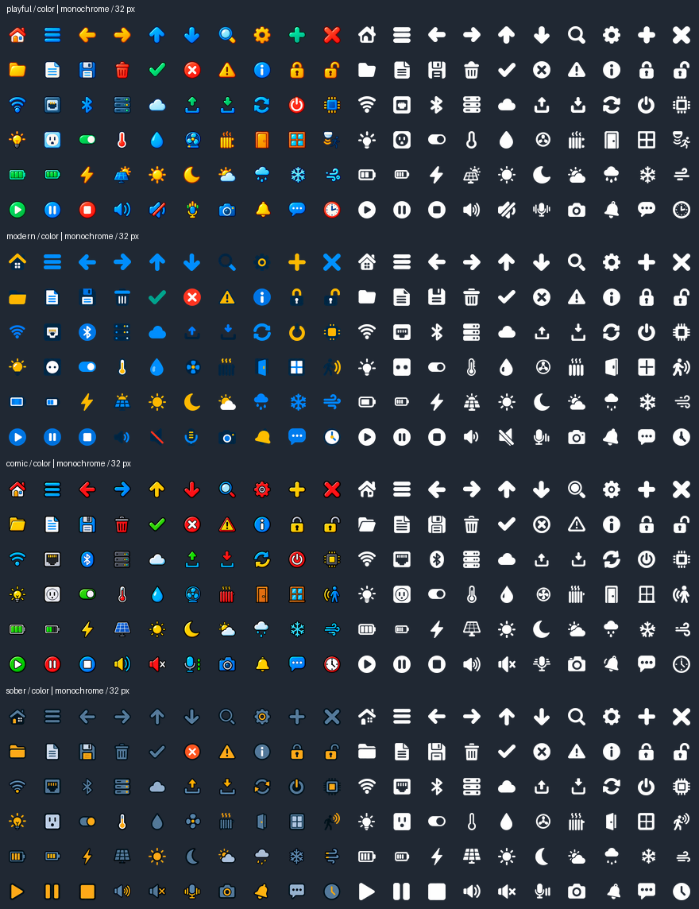

# CYD icon library

960 selectable variants: 60 shared motif IDs × four styles (`playful`, `modern`,
`comic`, `sober`) × two colour modes (`color`, `mono`) × still/animated.
The four export sizes are 24, 32, 48 and 64 device pixels.

For dark device surfaces, the tintable monochrome variants offer the clearest
contrast; modern colour icons deliberately retain dark navy details. Check
the picker against the actual background before using those at 24 pixels.

## Artwork and reproducibility

All masters in `sources/` were generated with the built-in ImageGen tool on
2026-10-15. `style-reference.png` establishes home, settings, Wi-Fi, bulb, fan
and warning for each style. The eight 10×6 motif atlases reference this board;
each pair of 6×6 motion atlases references its matching motif atlas. Exact
generation prompts are in `prompts/`. `playful-mono-download-repair.png` is an
ImageGen edit of `playful-mono-motion-0.png`; only its corrected third row is
used. The original atlas is retained for provenance.

Run `python scripts/export-cyd-icons.py` from the repository root (Pillow).
`--check` regenerates in memory and compares every byte and manifest hash.
`--contact-sheets reports/cyd-icons/contact-sheets` writes every combination at
native size on light and dark backgrounds. Reviewed gutter exceptions in the
exporter keep detached rain drops with their cloud. All frames of a motif use
one union bounding box, scale and centre. Artwork occupies at most 70% of the
square, leaving room for rotation and small translations. No generated master
is shipped to the device.

The 3,840 runtime PNGs and strict SHA-256 manifest live in `ui/img/cyd-icons/`,
part of the verified external web resource pack. `export-manifest.json` records
source hashes, dimensions, counts and the runtime manifest hash. PNGs are
authoring/preview/portable-project files. Firmware stores constant RGB565,
RGB565A8 or A8 arrays; it needs no PNG/GIF decoder. Monochrome masters are
independent white silhouettes with transparent negative space, not grayscale
conversions of the colour set. Exports preserve their alpha as a tintable mask.

## Motion and device budgets

Wi-Fi, upload, download, bulb, fan, charging battery, rain, snow, wind, volume,
microphone and bell have six ImageGen frames at six frames per second. Frame
zero is also the still/reduced-motion poster. Other icons use pulse, bob or
rotation; sober icons use a restrained pulse. Native firmware updates run at
84 ms (less than 12 Hz); invisible/off-screen icons do no animation updates,
and deleting a widget deletes its timer and state. The frame arrays stay in
flash. Only the displayed image and timer state consume runtime memory.

32 px is the default below 800×480, 48 px on 800×480. The existing board budget
is 256 KiB for flash profiles below 8 MB and 4 MiB otherwise, regardless of
PSRAM. A 32 px transparent colour image uses 3,072 bytes, A8 uses 1,024;
six distinct frames use 18,432 or 6,144 bytes, plus small descriptors and
runtime state. Content hashes deduplicate repeated imports and shared frames.
Only imported sizes/variants enter a project, never the entire library.

## Acceptance

Automated coverage includes all 3,840 manifest files, alpha/dimensions, A8
conversion, exact budgets, content deduplication, partial failure, revision
restore, ZIP round trips, route permissions and old static-image goldens.
The icon fixture is generated for all nine profiles and is included in the
opt-in builder compile matrix (`CYD_BUILDER_IT_ONLY=icons`). Browser coverage
uses Standard/Fruity, both motion preferences, keyboard selection, images and
buttons, tint, style changes, undo/redo, delayed imports and budget recovery.

Firmware compilation requires the Docker builder. Hardware acceptance still
requires a classic CYD without PSRAM and an S3 with PSRAM: check small-icon
recognition on both backgrounds, touch latency, free/minimum heap, Wi-Fi
activity, repeated screen switches, hiding and deleting animated widgets.
Existing community board labels remain unchanged until device verification.

LVGL references: [images](https://lvgl.io/docs/open/9.5/widgets/image.html),
[image sequences](https://lvgl.io/docs/open/9.5/widgets/animimg.html).
