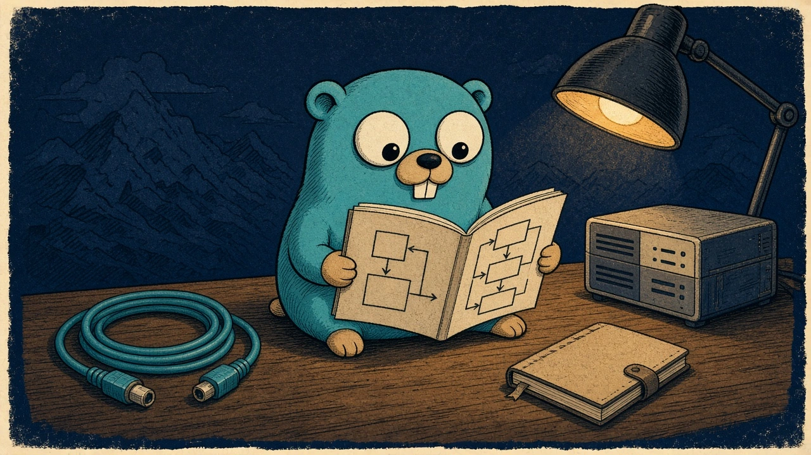
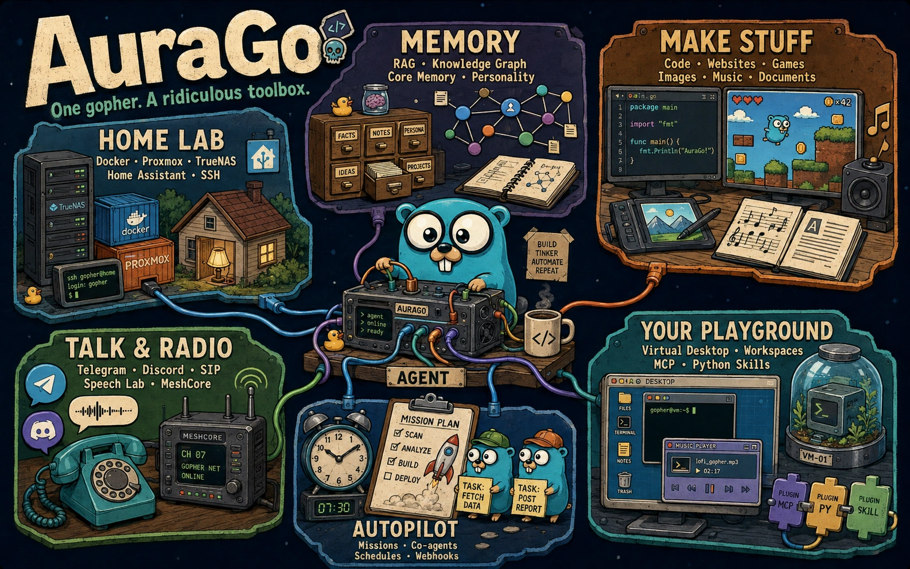

  

<h1 align="center">AuraGo Handbook</h1>

<strong>Same gopher. More pages.</strong>

The root README is the postcard. This is the field guide: install it, talk to it, plug in the toys, and keep the vault locked.

  <a href="de/README.md">Deutsches Handbuch</a> · <a href="en/README.md">English manual</a> · <a href="de/faq.md">FAQ DE</a> · <a href="en/faq.md">FAQ EN</a>

## Jump in

| If you want to… | Start here |
|---|---|
| Install it | [Installation DE](de/02-installation.md) · [Installation EN](en/02-installation.md) |
| Talk to it in five minutes | [Schnellstart](de/03-quickstart.md) · [Quick start](en/03-quickstart.md) |
| See the desktop | [Web-UI DE](de/04-webui.md) · [Web UI EN](en/04-webui.md) |
| Plug things in | [Integrationen](de/08-integrations.md) · [Integrations](en/08-integrations.md) |
| Keep secrets secret | [Sicherheit](de/14-security.md) · [Security](en/14-security.md) |
| Unstick it | [Troubleshooting DE](de/16-troubleshooting.md) · [Troubleshooting EN](en/16-troubleshooting.md) |

## Reading paths

| Path | Route |
|------|-------|
| 🌱 **First contact** | 01 → 02 → 03 → 04 → 05 |
| 🔌 **The workbench** | 08 → 06 → 13 → 20 |
| 🛡️ **Run & harden** | 07 → 14 → 16 → 23 |
| 🧠 **Automation** | 09 → 10 → 11 → 15 → 19 → 22 |
| 📖 **Look it up** | 17 · 18 · 21 · FAQ |

Full maps with parts and one-liners: [Deutsche Übersicht](de/README.md) · [English overview](en/README.md).

## All chapters

| Chapter | Deutsch | English | One line |
|---------|---------|---------|----------|
| 01 · Introduction | [Einführung](de/01-introduction.md) | [Introduction](en/01-introduction.md) | What it is, and what it is not |
| 02 · Installation | [Installation](de/02-installation.md) | [Installation](en/02-installation.md) | Binary, Docker, build, resource set |
| 03 · Quick start | [Schnellstart](de/03-quickstart.md) | [Quick start](en/03-quickstart.md) | The first five minutes |
| 04 · Web UI | [Web-Oberfläche](de/04-webui.md) | [Web UI](en/04-webui.md) | Chat, desktop, Config, themes |
| 05 · Chat basics | [Chat-Grundlagen](de/05-chat-basics.md) | [Chat basics](en/05-chat-basics.md) | How to talk to the agent |
| 06 · Tools | [Werkzeuge](de/06-tools.md) | [Tools](en/06-tools.md) | The big toolbox |
| 07 · Configuration | [Konfiguration](de/07-configuration.md) | [Configuration](en/07-configuration.md) | Provider system and fine-tuning |
| 08 · Integrations | [Integrationen](de/08-integrations.md) | [Integrations](en/08-integrations.md) | From NAS boxes to radios |
| 09 · Memory | [Gedächtnis](de/09-memory.md) | [Memory](en/09-memory.md) | History, core facts, RAG, graph |
| 10 · Personality | [Persönlichkeit](de/10-personality.md) | [Personality](en/10-personality.md) | Same toolbox, different attitude |
| 11 · Mission Control | [Mission Control](de/11-missions.md) | [Mission Control](en/11-missions.md) | Scheduled work |
| 12 · Invasion Control | [Invasion Control](de/12-invasion.md) | [Invasion Control](en/12-invasion.md) | Eggs and nests |
| 13 · Dashboard | [Dashboard](de/13-dashboard.md) | [Dashboard](en/13-dashboard.md) | Numbers, issues, affect, 3D graph |
| 14 · Security | [Sicherheit](de/14-security.md) | [Security](en/14-security.md) | Vault, jail, Guardian, 2FA |
| 15 · Co-agents | [Co-Agenten](de/15-coagents.md) | [Co-agents](en/15-coagents.md) | Helpers for subtasks |
| 16 · Troubleshooting | [Troubleshooting](de/16-troubleshooting.md) | [Troubleshooting](en/16-troubleshooting.md) | When you only get the recovery page |
| 17 · Glossary | [Glossar](de/17-glossary.md) | [Glossary](en/17-glossary.md) | Terms |
| 18 · Appendix | [Anhang](de/18-appendix.md) | [Appendix](en/18-appendix.md) | Short reference |
| 19 · Skills | [Skills](de/19-skills.md) | [Skills](en/19-skills.md) | Python skills and Agent Skills |
| 20 · Chat commands | [Chat-Commands](de/20-chat-commands.md) | [Chat commands](en/20-chat-commands.md) | Slash commands right in the chat |
| 21 · API reference | [API-Referenz](de/21-api-reference.md) | [API reference](en/21-api-reference.md) | REST endpoints, SSE, auth |
| 22 · Internal tools | [Interne Tools](de/22-internal-tools.md) | [Internal tools](en/22-internal-tools.md) | The full tool catalog |
| 23 · Internals | [Interna](de/23-internals.md) | [Internals](en/23-internals.md) | Modules, data flow, architecture |
| 24 · EasyDrag | [EasyDrag](de/24-easydrag.md) | [EasyDrag](en/24-easydrag.md) | Automations by drag and drop |
| 25 · CYD Creator | [CYD Creator](de/25-cyd-creator.md) | [CYD Creator](en/25-cyd-creator.md) | Apps for the Cheap Yellow Display |
| 26 · Video Studio | [Video Studio](de/26-video-studio.md) | [Video Studio](en/26-video-studio.md) | Multitrack video editor, off by default |
| 27 · Bookshelf | [Bookshelf](de/27-bookshelf.md) | [Bookshelf](en/27-bookshelf.md) | Library and ebook reader |
| 28 · Mailer | [Mailer](de/28-mailer.md) | [Mailer](en/28-mailer.md) | IMAP, POP3, SMTP, gog and AgentMail |
| 29 · Infra | [Infra](de/29-infra.md) | [Infra](en/29-infra.md) | The homelab atlas |
| 30 · RuView | [RuView](de/30-ruview.md) | [RuView](en/30-ruview.md) | Experimental Wi-Fi sensing |
| FAQ | [FAQ](de/faq.md) | [FAQ](en/faq.md) | Quick answers |

## What this book is

AuraGo is a self-hosted Go agent for a home lab. The backend is one portable binary. The full browser UI is a **matching local resource set** — only a small recovery/login page lives inside the executable. Bring a local or hosted model. Enable the tools you actually want.

These chapters stay in sync with the product, not with a marketing checklist. If a sentence and the code disagree, the code wins. Deep dives for MeshCore, Game Maker, SIP, Speech Lab, Docker and web assets live next to this handbook under [`documentation/`](../).

**Stand: 19. Oktober 2026.** Both languages cover the same 30 chapters. German uses *du*.

## Nearby docs

- [Configuration reference](../configuration.md)
- [Docker](../docker_installation.md)
- [Web assets / recovery UI](../web-assets.md)
- [Architecture](../architecture.md)
- [Telegram](../telegram_setup.md)
- [Security introduction](../security_introduction.md)
