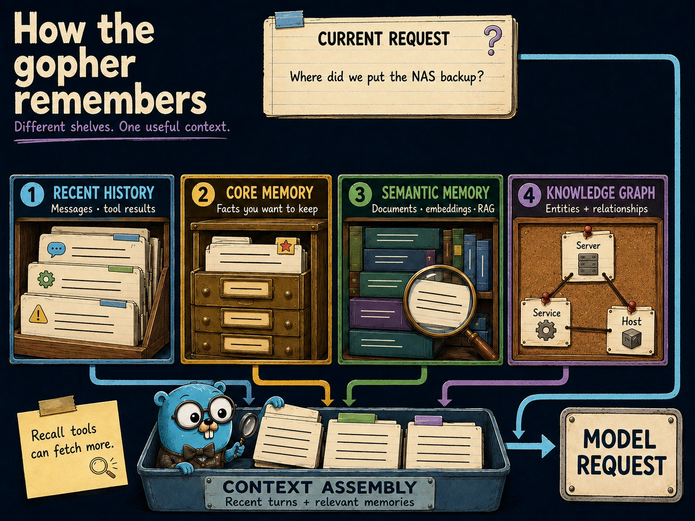

# Kapitel 9: Gedächtnis & Wissen

<p align="center">
  <a href="../../../assets/readme/gopher-memory-map.webp"></a>
</p>

Mehrere Regale, ein nützlicher Kontext. Die Zeichnung vereinfacht — sie ist kein Screenshot.

> [!NOTE]
> Dieses Kapitel beschreibt die aktuelle Implementierung. Einige fortgeschrittene Features aus früheren Versionen (wie konfigurierbare RAG-Parameter) sind in der aktuellen Version nicht verfügbar.

---

## Inhaltsverzeichnis

1. [Übersicht des Gedächtnissystems](#übersicht-des-gedächtnissystems)
2. [Kurzzeitgedächtnis (STM)](#kurzzeitgedächtnis-stm)
3. [Langzeitgedächtnis (LTM) / Embeddings](#langzeitgedächtnis-ltm--embeddings)
4. [Knowledge Graph](#knowledge-graph)
5. [Kernspeicher (Core Memory)](#kernspeicher-core-memory)
6. [Notizen & Aufgaben](#notizen--aufgaben)
7. [File KG Sync](#file-kg-sync)
8. [Funktionsweise des Gedächtnisses in Gesprächen](#funktionsweise-des-gedächtnisses-in-gesprächen)
9. [Wissen speichern und abrufen](#wissen-speichern-und-abrufen)
10. [Memory-Konfiguration](#memory-konfiguration)
11. [Memory-Optimierung](#memory-optimierung)
12. [Knowledge Indexing (Datei-Indexierung)](#knowledge-indexing-datei-indexierung)
13. [Helper LLM — Automatisierte Wartung](#helper-llm--automatisierte-wartung)
14. [Best Practices](#best-practices)
15. [Fehlerbehebung](#fehlerbehebung)

---

## Übersicht des Gedächtnissystems

AuraGo implementiert ein hierarchisches Gedächtnismodell:

| Gedächtnistyp | Speichermedium | Zugriffsgeschwindigkeit | Verfallsdauer |
|---------------|----------------|------------------------|---------------|
| **Kurzzeitgedächtnis (STM)** | SQLite | Sehr schnell | Konfigurierbar (Standard: letzte Nachrichten) |
| **Kernspeicher (Core Memory)** | SQLite (ältere `core_memory.md` wird migriert) | Sofort | Permanent |
| **Langzeitgedächtnis (LTM)** | Vektordatenbank | Schnell | Permanent (wenn aktiviert) |

```text
┌─────────────────────────────────────────────────────────┐
│                    Memory Layers                        │
├─────────────────────────────────────────────────────────┤
│  Core Memory       │ Permanente Fakten, Präferenzen     │
├───────────────────┬┴─────────────────────────────────────┤
│  Short-Term       │ Aktuelle Gesprächshistorie          │
│  Memory (STM)     │ SQLite-basiert, Kontextfenster      │
├───────────────────┼─────────────────────────────────────┤
│  Long-Term        │ Vektor-Embeddings, semantische Suche│
│  Memory (LTM)     │ Über konfigurierten Embeddings-Provider│
├───────────────────┼─────────────────────────────────────┤
│  Knowledge Graph  │ Entitäten, Beziehungen, Fakten      │
│                   │ Strukturiertes Wissensnetz          │
├───────────────────┼─────────────────────────────────────┤
│  Notizen & Aufgaben│ Kategorisiert, priorisiert          │
│                   │ Umsetzbare Einträge mit Fälligkeit  │
└─────────────────────────────────────────────────────────┘
```

---

## Kurzzeitgedächtnis (STM)

Das Kurzzeitgedächtnis speichert die unmittelbare Gesprächshistorie in einer SQLite-Datenbank.

### Konfiguration

### Einrichtung in der Web-UI
1. Öffne **Config → Server → SQLite**.
2. Passe bei Bedarf den Pfad für die Kurzzeit-Datenbank an.
3. Speichern.

### YAML-Referenz
```yaml
# config.yaml - STM-Konfiguration
sqlite:
  short_term_path: "./data/short_term.db"  # Pfad zur SQLite-Datenbank
```

### Funktionsweise

- **Automatische Speicherung:** Jede Konversation wird automatisch in der SQLite-Datenbank gespeichert
- **Kontext-Fenster:** Der Agent berücksichtigt die letzten Nachrichten bei jeder Anfrage
- **Persistenz:** Überlebt Neustarts des Agents

---

## Langzeitgedächtnis (LTM) / Embeddings

Bei Neuinstallationen läuft dieses Feature standardmäßig lokal (`embeddings.provider: "local-granite"`). Bestehende Provider-Auswahlen werden nicht verändert.

Das Langzeitgedächtnis ermöglicht semantische Suche über vergangene Gespräche mittels Vektordatenbank.

### Konfiguration

### Einrichtung in der Web-UI
1. Öffne **Config → Embeddings**.
2. Wähle **Lokales Granite – automatisch**, einen vorhandenen Provider oder **Deaktiviert**.
3. Speichere. Beim ersten lokalen Start lädt AuraGo die geprüften Modell- und Runtime-Dateien im Hintergrund herunter und ermittelt den schnellsten zuverlässigen GPU-Pfad. Falls kein GPU-Pfad funktioniert, wird automatisch die CPU verwendet.

### YAML-Referenz
```yaml
# config.yaml - LTM/Embeddings-Konfiguration
embeddings:
  provider: "local-granite"               # Standard für Neuinstallationen
  local:
    backend: "auto"                       # auto/cpu/cuda/coreml/metal/vulkan
    context_size: 2048
    batch_size: 2048
  internal_model: "qwen/qwen3-embedding-8b"  # Modell für internen Provider
  external_url: "http://localhost:11434/v1"  # Für externen Provider (z.B. Ollama)
  external_model: "nomic-embed-text"         # Modell für externen Provider
```

### Provider-Optionen

| Provider | Beschreibung |
|----------|--------------|
| `local-granite` | Lokales, mehrsprachiges Granite-97M-Modell; GPU automatisch, CPU-Fallback |
| `disabled` | Langzeitgedächtnis deaktiviert |
| `internal` | Nutzt das Haupt-LLM für Embeddings |
| Provider-ID | Verwendet einen konfigurierten Provider-Eintrag |

Unter Linux benötigt der native Vulkan-Pfad Lese- und Schreibzugriff auf ein
`/dev/dri/renderD*`-Gerät. Die AuraGo-Installer ergänzen vorhandene Gruppen
`render` und `video` automatisch über `SupplementaryGroups` im systemd-Dienst.
Zusätzlich reichen sie deren numerische Host-GIDs als
`AURAGO_GPU_GROUP_IDS` an verwaltete Vulkan-Container weiter. Dadurch erhält
der Sidecar die erforderlichen Docker-Zusatzgruppen, ohne die dauerhaften
Gruppenmitgliedschaften des Dienstbenutzers zu verändern. Bei Docker-Compose
kannst du die Variable selbst als kommagetrennte Liste der Host-GIDs setzen.
Eigene Service-Units müssen gleichwertigen Zugriff erlauben; andernfalls wird
Vulkan übersprungen und CPU bleibt verfügbar.

### Speicherort

```text
data/vectordb/       # Vektordatenbank (chromem-go) — Langzeit-Speicher (LTM)
data/embeddings/      # Geprüfte Modelle, native Runtimes und Benchmark-Auswahl
```

Lokales Granite ist ausschließlich für Text gedacht und liefert 384-dimensionale, normalisierte Vektoren. AuraGo bleibt mit `CGO_ENABLED=0` baubar: ONNX läuft in einem isolierten AuraGo-Worker, GGUF in einem überwachten `llama-server`. In Docker verwendet AuraGo digest-gepinnte b9994-Sidecar-Images ohne veröffentlichten Host-Port und reicht NVIDIA- beziehungsweise `/dev/dri`-Geräte an die Probe weiter. Der Status in der Web-UI erklärt Downloads, GPU-Nutzung und jeden Fallback.

`sqlite.long_term_path` ist veraltet und wird nur noch für ältere Installationen mit einer bestehenden `long_term.db` berücksichtigt.

---

## Knowledge Graph

Der Knowledge Graph speichert strukturierte Entitäten und Beziehungen. Er ergänzt die semantische Suche, weil AuraGo dadurch nicht nur Textstellen findet, sondern Zusammenhänge zwischen Personen, Geräten, Diensten, Projekten, Orten oder Konzepten verfolgen kann.

### Typische Entitäten und Beziehungen

| Entität | Beispiele |
|---------|-----------|
| Person | Kontakte, Teammitglieder, Verantwortliche |
| Gerät | Server, VMs, Router, NAS, IoT-Geräte |
| Dienst | Home Assistant, Docker-Container, Datenbanken |
| Projekt | Aufgaben, Repositories, Dokumentationen |
| Konzept | Architekturentscheidungen, Risiken, Standards |

Beziehungen können z. B. `runs_on`, `depends_on`, `owned_by`, `uses`, `related_to` oder `located_at` sein.

### Qualität und Schutz

| Feature | Zweck |
|---------|-------|
| **Quality Reports** | Isolierte Nodes, untypisierte Nodes und mögliche Duplikate finden |
| **Protected Nodes** | Kritische Entitäten vor automatischer Bereinigung schützen |
| **Access Tracking** | Kürzlich genutzte Nodes für bessere Retrieval-Relevanz berücksichtigen |
| **Semantische Indexierung** | Graph-Suche mit Embedding-gestützter Suche verbessern, wenn aktiviert |

Die Web-UI und API stellen Suche, Statistiken, Qualitätsberichte, wichtige Nodes und Node-Schutz über `/api/knowledge-graph/*` bereit. Aktivierung und Extraktion: **Config → Tools → Tool-Berechtigungen** (`knowledge_graph`) bzw. **Config → Integrationen → Knowledge Graph** (Auto-Extraktion, siehe Kapitel 8).

---

## Kernspeicher (Core Memory)

Der Kernspeicher enthält permanente Fakten, die AuraGo über den Benutzer und die Umgebung wissen sollte.

### Speicherort

```text
SQLite (nach Start-Migration; eine alte data/core_memory.md wird nach .migrated verschoben)
```

### Struktur

Die Datei wird automatisch verwaltet. Der Agent kann Fakten hinzufügen mit:

```text
Du: Merke dir: Mein Name ist Max und ich arbeite mit Go
Agent: ✅ In Core Memory gespeichert
```

### Konfiguration

### Einrichtung in der Web-UI
1. Öffne **Config → Agent → Optimierungen** (Gruppe **Tool-Kontext**).
2. Setze **Core Memory Max Entries** und **Cap Mode**.
3. Speichern.

### YAML-Referenz
```yaml
# config.yaml
agent:
  core_memory_max_entries: 80       # Maximale Anzahl Einträge
  core_memory_cap_mode: "hard"      # "hard" lehnt Überlauf ab
```

| Modus | Beschreibung |
|-------|--------------|
| `soft` | Weiche Begrenzung, ältere Einträge werden priorisiert |
| `hard` | Harte Begrenzung, überschüssige Einträge werden entfernt |

> [!WARNING]
> Der Kernspeicher ist immer im Prompt enthalten. Halte ihn kurz (empfohlen unter 500 Tokens), um übermäßige API-Kosten zu vermeiden.

---

## Notizen & Aufgaben

Ein strukturiertes System für umsetzbare Informationen mit Kategorien, Prioritäten und Fälligkeitsdaten.

### Notizen

**Notizen erstellen:**
```text
Du: Speichere als Notiz: Server-IP ist 192.168.1.100
Du: Notiz: Meeting-Notizen von heute - Q4-Ziele besprochen
```

**Notiz-Kategorien:**
- Arbeit
- Privat
- Ideen
- Referenz
- Lernen

**Notizen suchen:**
```text
Du: Finde meine Notizen zum Server
→ Zeigt alle Notizen mit "Server"
```

### Aufgaben (To-Dos)

**Aufgaben erstellen:**
```text
Du: Füge Aufgabe hinzu: Einkaufen morgen
Du: Task: Bericht bis Freitag einreichen, hohe Priorität
```

**Aufgaben-Eigenschaften:**

| Eigenschaft | Optionen |
|-------------|----------|
| Priorität | Niedrig, Normal, Hoch, Kritisch |
| Status | Offen, In Bearbeitung, Erledigt, Abgebrochen |
| Fälligkeit | Bestimmtes Datum, relative Zeit |
| Kategorie | Arbeit, Privat, Gesundheit, Finanzen, etc. |
| Wiederkehrend | Täglich, Wöchentlich, Monatlich |

**Aufgaben verwalten:**
```text
Du: Zeige meine Aufgaben
Du: Markiere Einkaufen als erledigt
Du: Welche Aufgaben sind diese Woche fällig?
```

---

## File KG Sync

File KG Sync ist ein Hintergrunddienst, der Datei-Indexierung und Knowledge Graph verbindet. Wenn der FileIndexer unterstützte Dateien findet oder aktualisiert, kann der Sync-Dienst Entitäten, Beziehungen und Quellen aus indexierten Chunks extrahieren und in den Knowledge Graph schreiben.

### Ablauf

| Schritt | Beschreibung |
|---------|--------------|
| Index | Der FileIndexer scannt konfigurierte Verzeichnisse und speichert durchsuchbare Chunks |
| Extraktion | Ein LLM extrahiert mögliche Entitäten und Beziehungen aus indexierten Inhalten |
| Scoring | Extrahierte Einträge erhalten Confidence- und Quellen-Metadaten |
| Merge | Bestehende Nodes werden wiederverwendet, um Duplikate zu vermeiden |
| Cleanup | Verwaiste dateibasierte Entitäten können erkannt und bereinigt werden |

Dadurch werden hochgeladene oder indexierte Dokumente sowohl über semantisches RAG als auch über strukturierte Graph-Abfragen nutzbar. Ein Server-Runbook kann z. B. Nodes für Dienste, Hosts, Ports, Verantwortliche und Abhängigkeiten erzeugen.

### Debug- und Wartungsendpunkte

| Endpunkt | Zweck |
|----------|-------|
| `GET /api/debug/kg-file-sync-stats` | Statistiken zur Datei-zu-Graph-Synchronisation |
| `GET /api/debug/kg-orphans` | Dateibasierte Graph-Nodes ohne aktuelle Quellen |
| `GET /api/debug/file-sync-status` | Aktueller Sync-Status |
| `GET /api/debug/file-sync-last-run` | Details zum letzten Sync-Lauf |
| `GET /api/debug/kg-file-entities` | Aus Dateien erzeugte Entitäten |
| `GET /api/debug/kg-node-sources` | Quellen hinter Graph-Nodes |
| `POST /api/debug/kg-file-sync-cleanup` | Verwaiste dateibasierte Graph-Daten bereinigen |

### Praxisempfehlung

Halte indexierte Verzeichnisse fokussiert und vermeide riesige, unstrukturierte Verzeichnisbäume. File KG Sync funktioniert am besten mit Runbooks, Inventaren, Projektnotizen, Architektur-Dokumentation, Konfigurationsreferenzen und anderen halbstrukturierten Wissensquellen.

---

## Funktionsweise des Gedächtnisses in Gesprächen

### Die Memory-Pipeline

```text
┌──────────────────────────────────────────────────────────┐
│  1. Nutzereingabe                                          │
└────────────────┬─────────────────────────────────────────┘
                 │
                 ▼
┌──────────────────────────────────────────────────────────┐
│  2. Memory-Abruf                                           │
│     • STM: Aktueller Kontext                              │
│     • LTM: Semantische Suche nach passenden Erinnerungen  │
│     • Core: Immer enthaltene Fakten                       │
│     • Knowledge Graph: Relevante Entitäten                │
│     • Notizen/Aufgaben: Passende Einträge                 │
└────────────────┬─────────────────────────────────────────┘
                 │
                 ▼
┌──────────────────────────────────────────────────────────┐
│  3. Kontext-Zusammenstellung                               │
│     System-Prompt + Core + STM + abgerufene Erinnerungen  │
└────────────────┬─────────────────────────────────────────┘
                 │
                 ▼
┌──────────────────────────────────────────────────────────┐
│  4. LLM-Verarbeitung → Antwort                            │
└────────────────┬─────────────────────────────────────────┘
                 │
                 ▼
┌──────────────────────────────────────────────────────────┐
│  5. Memory-Speicherung                                    │
│     • STM: Gesprächs-Turn speichern                       │
│     • LTM: Wichtige Fakten → Vektor-DB                    │
│     • Knowledge Graph: Neue Entitäten/Beziehungen         │
│     • Notizen/Aufgaben: Bei expliziter Erstellung         │
└──────────────────────────────────────────────────────────┘
```

### Memory-Abruf-Priorität

Beim Antworten ruft AuraGo Erinnerungen in dieser Prioritätsreihenfolge ab:

1. **Kernspeicher** – Immer enthalten
2. **STM-Kontext** – Letzte N Nachrichten
3. **LTM-Treffer** – Top-K semantische Ergebnisse (Standard: 5)
4. **Knowledge Graph** – In der Anfrage genannte Entitäten
5. **Aktive Aufgaben** – Offene Einträge (falls relevant)

---

## Wissen speichern und abrufen

### Manuelle Speicherung

```text
Du: Merke dir: Ich bevorzuge PostgreSQL über MySQL
Agent: ✅ Gespeichert: "Ich bevorzuge PostgreSQL über MySQL"

Du: Notiere: Meeting mit Team am Freitag 14 Uhr
Agent: ✅ Notiz gespeichert
```

### Abfrage

```text
Du: Was ist meine bevorzugte Datenbank?
Agent: Laut meiner Notiz bevorzugst du PostgreSQL über MySQL.
```

### Automatische Extraktion

AuraGo extrahiert und speichert automatisch:

```text
Du: Ich fliege nächsten Dienstag nach Paris zu einer Konferenz
↓ Extrahiert:
   • LTM: Reiseplan nach Paris
   • Knowledge Graph: Event(Konferenz), Ort(Paris), Datum(Nächster Dienstag)
   • Kein expliziter Befehl nötig
```

### Abruf-Muster

**Zeitliche Abfragen:**
```text
"Was haben wir letzte Woche besprochen?"
"Erinnere mich an das, was ich zum Budget sagte"
"Zeige mir Gespräche aus dem März"
```

**Themen-Abfragen:**
```text
"Erzähl mir von meinem Smart-Home-Projekt"
"Was weiß ich über Machine Learning?"
"Finde Informationen zur Server-Konfiguration"
```

**Entitäts-Abfragen:**
```text
"Wer ist Sarah?"
"Mit welchen Firmen habe ich Kontakte?"
"An welchen Projekten arbeite ich?"
```

---

## Memory-Konfiguration

> 🖥️ **Web-UI:** Konfiguriere das Gedächtnis unter **Config → Embeddings** (Langzeitgedächtnis), **Config → Agent** (Kompression und Core-Memory-Limits), **Config → Datenbanken** (SQLite-Pfade), **Config → Indexierung** (Wissensbasis-Indexierung) und **Config → Memory-Analyse** (Helper-LLM-Analyseoptionen).

Die tatsächliche Konfigurationsstruktur in `config.yaml`:

### YAML-Referenz
```yaml
# Embeddings-Konfiguration für LTM/RAG
embeddings:
  provider: "local-granite"         # Standard für Neuinstallationen
  local:
    backend: "auto"                 # auto/cpu/cuda/coreml/metal/vulkan
    context_size: 2048
    batch_size: 2048
  internal_model: "qwen/qwen3-embedding-8b"
  external_url: "http://localhost:11434/v1"
  external_model: "nomic-embed-text"
  api_key: "dummy_key"

# Agent-Einstellungen
agent:
  memory_compression_char_limit: 60000
  core_memory_max_entries: 80
  core_memory_cap_mode: "hard"

# SQLite-Datenbankpfade
sqlite:
  short_term_path: "./data/short_term.db"

# Langzeitgedächtnis (LTM) nutzt den eingebetteten Vektor-Speicher:
directories:
  vectordb_dir: "./data/vectordb"

# Wissens-Indexierung
indexing:
  enabled: true
  directories:
    - path: ./knowledge
      allow_media_analysis: false   # true erlaubt Bilder, Audio und gescannte PDFs (siehe unten)
  poll_interval_seconds: 60
  extensions:
    - .txt
    - .md
    - .json
    - .csv
    - .log
    - .yaml
    - .yml
```

### Konfigurations-Referenz

| Parameter | Standard | Beschreibung |
|-----------|----------|--------------|
| `embeddings.provider` | `"local-granite"` (Neuinstallationen) | Lokales Granite, `"disabled"`, `"internal"`, verwaltetes Ollama oder konfigurierte Provider-ID. Bestehende Auswahl bleibt erhalten. |
| `embeddings.local.backend` | `"auto"` | Benchmarkt passende GPU-Runtimes zuerst, dann gültige CPU-Runtimes. |
| `embeddings.local.context_size` | `2048` | Lokale Maximal-Token-Zahl pro Text. |
| `embeddings.local.batch_size` | `2048` | Lokale Runtime-Batch- und Micro-Batch-Größe. |
| `embeddings.internal_model` | `"qwen/qwen3-embedding-8b"` | Modell für interne Embedding-Generierung |
| `agent.memory_compression_char_limit` | `100000` | Zeichen vor Auslösen der STM-Kompression |
| `agent.core_memory_max_entries` | `80` | Maximale Core-Memory-Einträge |
| `agent.core_memory_cap_mode` | `"hard"` | Umgang mit Überlauf: `"hard"` lehnt ab, `"soft"` warnt |
| `sqlite.short_term_path` | `"./data/short_term.db"` | Pfad zur STM-SQLite-Datenbank |
| `indexing.enabled` | `true` | Automatische Wissensbasis-Indexierung aktivieren |

Lokales Granite ist text-only und liefert 384-dimensionale normalisierte Vektoren. Gepinnte ONNX-INT8- und GGUF-Q8_0-Modelle und Runtimes werden nach `data/embeddings/` mit Größen- und SHA-256-Prüfung heruntergeladen. AuraGo bleibt während des Setups verfügbar. Die Konfigurations-UI zeigt Download, Runtime, verifizierte GPU, Benchmark und Fallback-Details und kann die Erkennung erneut ausführen. ONNX/GGUF-Formatwechsel nutzen den kontrollierten Neustart/Reindex-Pfad, um das Vermischen von Vektor-Fingerprints zu vermeiden.

Auf Linux benötigt der native Vulkan-Pfad Lese- und Schreibzugriff auf ein `/dev/dri/renderD*`-Gerät. Die AuraGo-Installer ergänzen vorhandene `render`- und `video`-Gruppen automatisch über `SupplementaryGroups` im systemd-Dienst. Die Installer geben zusätzlich ihre numerischen Host-GIDs als `AURAGO_GPU_GROUP_IDS` weiter; verwaltete Vulkan-Container nutzen diese Werte über Docker `GroupAdd`, ohne die dauerhaften Gruppenmitgliedschaften des Dienstbenutzers zu verändern. Bei Docker-Compose kann die Variable als kommagetrennte Liste der Host-GIDs gesetzt werden. Ohne gleichwertigen Gerätezugriff wird die Vulkan-Prüfung übersprungen und CPU bleibt verfügbar.

---

## Memory-Optimierung

### Token-Nutzung verwalten

| Komponente | Typische Tokens | Optimierung |
|-----------|-----------------|--------------|
| System-Prompt | 500–1000 | Fest |
| Core Memory | 200–500 | Kurz halten |
| STM (20 Nachrichten) | 1000–2000 | Kontextfenster anpassen |
| LTM-Ergebnisse | 500–1500 | Retrieval-Einstellungen anpassen |
| **Gesamt pro Anfrage** | **2200–5000** | Kosten im Blick behalten |

### Reduzierung des Memory-Overheads

### Einrichtung in der Web-UI
1. Öffne **Config → Agent** und senke **Memory Compression Limit** und **Core Memory Max Entries**.
2. Öffne **Config → Embeddings** und setze den Provider auf **disabled**, falls Langzeitgedächtnis nicht benötigt wird.
3. Öffne **Config → Indexierung** und deaktiviere die Datei-Indexierung bei Nichtnutzung.
4. Speichern.

### YAML-Referenz
```yaml
# config.yaml - Memory-Optimierung
agent:
  memory_compression_char_limit: 30000   # Früher komprimieren
  core_memory_max_entries: 50            # Core Memory klein halten

embeddings:
  provider: "disabled"                   # LTM deaktivieren falls nicht benötigt

indexing:
  enabled: false                         # Datei-Indexierung deaktivieren
```

### Datenbank-Wartung

**Alte Konversationen bereinigen:**
```bash
# Über Web-UI → Einstellungen → Gedächtnis → Bereinigung
# Oder manuell aus data/short_term.db löschen
```

**LTM optimieren:**
```bash
# LTM liegt in directories.vectordb_dir (chromem)
# vectordb bei Migration/Wiederherstellung in Backups einbeziehen
```

### Memory-Kompression

Um den Kontext effizient zu nutzen, komprimiert AuraGo ältere Konversationen automatisch, sobald `memory_compression_char_limit` überschritten wird:

1. Werden ältere Nachrichten zusammengefasst
2. Wichtige Fakten werden extrahiert
3. Der Kontext bleibt erhalten, aber kompakter

**Manuelle Bereinigungsbefehle:**
```text
Du: Vergiss alles über dieses alte Projekt
Du: Lösche alle Notizen älter als 6 Monate
Du: Leere meine Aufgabenliste
```

---

## Knowledge Indexing (Datei-Indexierung)

AuraGo kann lokale Dateien automatisch indexieren für schnellen Zugriff.

### Konfiguration

### Einrichtung in der Web-UI
1. Öffne **Config → Indexierung**.
2. Aktiviere die Indexierung, wähle Verzeichnisse und Dateitypen. Die Medienfreigabe erteilst du pro Ordner (siehe unten).
3. Speichern.

### YAML-Referenz
```yaml
# config.yaml
indexing:
  enabled: true
  directories:
    - path: "./knowledge"     # Zu indexierende Verzeichnisse
      allow_media_analysis: false   # true erlaubt Bilder, Audio und gescannte PDFs (siehe unten)
  poll_interval_seconds: 60   # Prüfintervall für Änderungen
  extensions:                 # Zu indexierende Dateitypen
    - .txt
    - .md
    - .json
    - .csv
    - .log
    - .yaml
    - .yml
```

### Medien pro Ordner

Bilder, Audio und gescannte PDFs ohne Textebene werden nur an ein Modell geschickt, wenn der Ordner mit `allow_media_analysis: true` freigegeben ist (Standard: `false`). Bei `embeddings.multimodal: false` gehen Bilder an das Vision-LLM, sofern zusätzlich `indexing.index_images: true` gesetzt ist. Bei `embeddings.multimodal: true` gehen Bilder und Audio stattdessen an den multimodalen Embedding-Provider; das Vision-LLM wird dafür nicht genutzt. Gescannte PDFs ohne Textebene nutzen ihn in diesem Fall als Fallback. Ohne Freigabe werden solche Dateien nicht indexiert. Bilder und Audio, die aus diesem Ordner bereits indexiert wurden, werden lokal aus dem Index entfernt; es wird nichts gesendet. Gescannte PDFs, die eine frühere Version über den Fallback indexiert hat, werden nicht automatisch entfernt und bleiben, bis sich die Datei ändert. Um sie sofort zu entfernen, entferne den Ordner aus der Liste und füge ihn erneut hinzu; die Dateien werden dann ohne Fallback neu indexiert. Die Freigabe schaltest du in **Config → Indexierung** pro Ordner ein; beim Einschalten fragt AuraGo zur Bestätigung nach. Bei verschachtelten Ordnern entscheidet der tiefste konfigurierte Ordner, der die Datei enthält: Ein Unterordner kann Medien also verweigern, auch wenn der übergeordnete Ordner sie freigibt, und umgekehrt. Per API geht das mit `PATCH /api/indexing/directories` und dem Body `{"path": "...", "allow_media_analysis": true}`. Medien können den Host verlassen, wenn der Provider extern ist.

> [!NOTE]
> **Upgrade-Hinweis:** Bestehende Installationen müssen die Medienfreigabe pro Ordner erneut setzen. Bisher galten `index_images` und `multimodal` für alle Ordner.

### Verwendung

Lege Dateien im `knowledge/`-Verzeichnis ab. Der Agent kann dann darauf zugreifen:

```text
Du: Was steht in der dokumentation.txt?
Agent: [Inhalt der indexierten Datei]
```

---

## Helper LLM — Automatisierte Wartung

Der Helper LLM ist ein sekundäres, kostengünstigeres LLM, das Hintergrundwartungsaufgaben erledigt, um den Hauptagenten schnell und effizient zu halten.

### Übersicht

```text
┌──────────────────────────────────────────────────────────┐
│  Helper LLM — Hintergrundwartung                          │
├──────────────────────────────────────────────────────────┤
│                                                           │
│  • Turn-Analyse        → Extrahiert Fakten, Präferenzen │
│  • Tageszusammenfassung + KG → Zusammenfassung + Entitäten │
│  • Konsolidierung      → Stapel-Konsolidierung Gedächtnis│
│  • Speicherkomprimierung → Komprimiert Konversationshistorie│
│  • RAG-Stapel          → Stapel-RAG-Verarbeitung        │
│                                                           │
└──────────────────────────────────────────────────────────┘
```

### Operationen

| Operation | Beschreibung | Auslöser |
|-----------|--------------|----------|
| **Turn-Analyse** | Analysiert jeden Gesprächsstrang für Fakten, Präferenzen, Stimmung und ausstehende Aktionen | Nach jedem Strang |
| **Tageszusammenfassung + KG** | Tägliche Zusammenfassung + Wissensgraph-Extraktion | Tägliche Wartung |
| **Konsolidierung** | Konsolidiert Gesprächsstapel in Langzeitwissen | Periodisch |
| **Speicherkomprimierung** | Komprimiert alte Konversationshistorie | Zeichenlimit erreicht |
| **Inhaltszusammenfassungen** | Erstellt Zusammenfassungen von Inhalten | Bei Bedarf |
| **RAG-Stapel** | Stapelverarbeitung für Retrieval-Augmented Generation | Periodisch |

### Nächtliche Speicher-Hygiene

Die nächtliche Wartung hält Langzeit- und Journal-Einträge sauber:

- Exakt doppelte, automatisch erzeugte Journal-Fehlermeldungen werden konsolidiert.
- Veraltete Notizen mit niedriger Priorität werden archiviert – mit Limits pro Lauf und Verfolgung wiederholter Fehlversuche.
- Als `protected` oder `keep_forever` markierte Notizen werden nie automatisch archiviert.
- Automatisch extrahierte Behauptungen, ein Tool, eine Funktion, eine API oder ein Endpoint sei defekt, gelten als vorübergehend und gelangen nie ins Langzeitgedächtnis.
- Findings, die nur eine Prüfung durch den Nutzer rechtfertigen (Review-only) oder als riskant gelten, werden nie automatisch gelöscht.

### Turn-Analyse

Nach jedem Gesprächsstrang analysiert der Helper LLM:

**Gedächtnisanalyse:**
- **Fakten**: Konkrete Fakten über Benutzer/Projekt/Umgebung
- **Präferenzen**: Benutzerpräferenzen, Gewohnheiten, Arbeitsabläufe
- **Korrekturen**: Aktualisierungen previously bekannter Informationen
- **Ausstehende Aktionen**: Zurückgestellte Folgemaßnahmen

**Aktivitätszusammenfassung:**
- Benutzerabsicht und -ziel
- Vom Agenten durchgeführte Aktionen
- Ergebnisse und wichtige Punkte
- Ausstehende Punkte
- Wichtigkeitsstufe (1-4)

**Persönlichkeitsanalyse:**
- Benutzerstimmung und -emotion
- Angemessene Antwortstimmung für nächste Interaktion
- Trait-Deltas (Neugier, Gründlichkeit, Kreativität, Empathie, etc.)
- Emotionszustandsbeschreibung

### Dashboard-Überwachung

Helper-LLM-Statistiken im Dashboard → Bereich **LLM und Kosten** (Karte **Hilfs-LLM**) anzeigen:

```text
Helper LLM Statistiken
┌─────────────────────────────────────────────────────────┐
│  Status: Aktiviert ✓                                    │
│  Letztes Update: Vor 2 Minuten                          │
│                                                           │
│  Anfragen: 1.234      LLM-Aufrufe: 567               │
│  Cache-Treffer: 432 (35%)  Fallbacks: 12             │
│                                                           │
│  Gesparte Aufrufe: 89       Stapel-Artikel: 456      │
│                                                           │
│  Operationen:                                           │
│  • Turn-Analyse: 1.234 erfolgreich                     │
│  • Tageszusammenfassung + KG: 28 erfolgreich           │
│  • Konsolidierung: 5 erfolgreich                         │
│  • Speicherkomprimierung: 3 ausgelöst                  │
│  • Inhaltszusammenfassungen: 45 erfolgreich            │
│  • RAG-Stapel: 89 erfolgreich                          │
└─────────────────────────────────────────────────────────┘
```

### Konfiguration

### Einrichtung in der Web-UI
1. Öffne **Config → Agent → LLM Einstellungen**.
2. Aktiviere **Helper LLM** und wähle Provider/Modell.
3. Optional: **Config → Agent → Gedächtnisanalyse** für Turn-Analyse und Extraktion.
4. Speichern und bei Bedarf neu starten.

### YAML-Referenz
```yaml
llm:
  helper_enabled: true              # Helper LLM aktivieren (empfohlen)
  helper_provider: ""               # leer = Haupt-Provider; oder Provider-ID
  helper_model: ""                  # leer = auto; oder spezifisches kostengünstiges Modell
```

> [!TIP]
> **Empfehlung:** Aktiviere den Helper LLM und weise ihm ein kleineres, kostengünstiges Modell zu (z. B. `google/gemini-2.0-flash-001`). Ohne Helper sind viele Hintergrundfunktionen wie Turn-Analyse, Konsolidierung und Wissensgraph-Extraktion nicht vollständig verfügbar.

| Parameter | Standard | Beschreibung |
|-----------|----------|--------------|
| `helper_enabled` | `false` | Helper LLM aktivieren/deaktivieren |
| `helper_provider` | `""` | Provider-ID (leer = Haupt-Provider) |
| `helper_model` | `""` | Modell (leer = Haupt-Modell) |

---

## Best Practices

### Für Benutzer

#### ✅ Empfohlene Praktiken

1. **Wichtige Fakten explizit speichern**
   ```text
   Merke dir: Mein Server läuft auf Ubuntu 22.04 LTS
   ```

2. **Embeddings aktivieren für komplexe Projekte** (**Config → Agent → Embeddings**)
   ```yaml
   embeddings:
     provider: "local-granite"  # oder vorhandener eigener Provider
   ```

3. **Core Memory regelmäßig aufräumen**
   - Über die Memory-UI oder den Agenten, nicht über eine Markdown-Datei
   - Veraltete Fakten löschen oder ersetzen

#### ❌ Zu vermeiden

- Übermäßig lange Nachrichten ohne Struktur
- Speicherung sensibler Daten (Passwörter, API-Keys)
- Ignorieren der `memory_compression_char_limit` bei langsamen Antworten

### Für Administratoren

#### Backup-Strategie

```bash
# Wichtige Dateien sichern
cp data/short_term.db backup/
cp -r data/vectordb backup/  # Falls Embeddings aktiviert
```

#### Performance-Optimierung

| Problem | Lösung |
|---------|--------|
| Hoher RAM-Verbrauch | `embeddings.provider: disabled` setzen |
| Langsame Antworten | `memory_compression_char_limit` reduzieren |
| Große Datenbank | SQLite VACUUM ausführen |

### Zusammenfassung: Dos and Don'ts

| Praktik | Warum |
|----------|-------|
| Explizite "Merken"-Befehle nutzen | Stellt sicher, dass kritische Fakten gespeichert werden |
| Core Memory minimal halten | Reduziert Token-Kosten |
| Notizen konsistent kategorisieren | Einfacheres Abrufen |
| Prioritäten bei Aufgaben setzen | Besseres Aufgabenmanagement |
| Regelmäßig prüfen und bereinigen | Erhält die Performance |
| Spezifische Suchbegriffe verwenden | Besseres LTM-Abrufen |

**Empfohlener Arbeitsablauf:**
1. **Ersteinrichtung** – Kritische Fakten in den Core Memory aufnehmen
2. **Tägliche Nutzung** – STM für Gesprächsfluss, "Merken" für wichtige Fakten, Notizen für Referenzinfos
3. **Aufgabenmanagement** – Aufgaben mit Prioritäten, Fälligkeitsdaten, regelmäßige Prüfung
4. **Wöchentliche Übersicht** – Speichernutzung im Dashboard prüfen, Einträge bereinigen, Core Memory bei Bedarf aktualisieren

> [!TIP]
> Wenn du keine semantische Suche benötigst, kannst du Embeddings weiterhin auf `disabled` setzen. Ein vorhandener eigener Provider bleibt ebenfalls vollständig unterstützt.

---

## Fehlerbehebung

| Problem | Ursache | Lösung |
|---------|---------|--------|
| Helper LLM zeigt "deaktiviert" | Feature nicht aktiviert | Aktiviere **Helper LLM** unter **Config → Agent → LLM Einstellungen** (`llm.helper_enabled: true`) |
| Hohe Helper-LLM-Kosten | Zu häufige Operationen | Operationsfrequenz reduzieren |
| Keine Turn-Analyse | Provider unterstützt keine Function Calls | Fähiges Modell verwenden |
| Zu hohe Cache-Miss-Rate | Cache häufig geleert | Cache-Speichereinstellungen prüfen |
| "Ich habe vergessen, was wir besprochen haben" | STM geleert | Prüfen, ob `/reset` genutzt wurde; LTM-Abruf prüfen |
| Hohe API-Kosten | Zu viel Kontext | Kontextfenstergröße reduzieren |
| Irrelevante Erinnerungen abgerufen | Embedding-Mismatcch | `embeddings.provider` prüfen |
| Fehlende Informationen | Nicht gespeichert oder abgelaufen | Explizite "Merken"-Befehle nutzen |
| LTM funktioniert nicht | Embeddings deaktiviert | `embeddings.provider` auf "internal" oder Provider-ID setzen |

---

**Vorheriges Kapitel:** [Kapitel 8: Integrationen](./08-integrations.md)
**Nächstes Kapitel:** [Kapitel 10: Persönlichkeit](./10-personality.md)
