# Kapitel 13: Dashboard

<p align="center">
  <a href="../../../assets/readme/system-wiring.svg"></a>
</p>

Zahlen, Issues, Affect, 3D-Graph. Kein zweiter Chat.

Erreichbar unter `http://localhost:8088/dashboard` oder über das Radialmenü (☰ → 📊 Dashboard). Bei aktivierter Web-UI-Authentifizierung ist ein Login erforderlich.

## Inhaltsverzeichnis

1. [Aufbau](#aufbau)
2. [Lagebild](#lagebild)
3. [Agent](#agent)
4. [Wissen](#wissen)
5. [Betrieb](#betrieb)
6. [Analyse](#analyse)
7. [Operational Issues](#operational-issues)
8. [Mood-Zustände](#mood-zustände)
9. [Echtzeit-Updates (SSE)](#echtzeit-updates-sse)
10. [Dashboard-API-Übersicht](#dashboard-api-übersicht)
11. [Tipps](#tipps)
12. [Fehlerbehebung](#fehlerbehebung)
13. [Nächste Schritte](#nächste-schritte)

---

## Aufbau

Die Kopfzeile enthält das Logo, eine reine Symbol-Schaltfläche für das Menü (ihr zugänglicher Name ist „Bereichsmenü“; nur in Fenstern bis 900 px Breite sichtbar), eine Dichte-Schaltfläche, die den aktuellen Modus **Komfortabel** oder **Kompakt** anzeigt und per Klick umschaltet, und die Theme-Schaltfläche. Darunter liegt links die Seitenleiste und rechts der aktive Bereich.

```text
┌───────────────────────────────────────────────────────────────────────────────────┐
│ AuraGo                           [☰]       [Komfortabel]        [Theme]           │
├──────────────────────────────┬────────────────────────────────────────────────────┤
│ ● Alles gut                  │ Lagebild                                           │
│ ● Bereit · ● Live            │ [einzeilige Beschreibung]                          │
│                              │ Aktualisiert 09:41:12                           ⟳  │
│ Lagebild                 [2] │                                                    │
│ AGENT                        │ [Karten des aktiven Bereichs, 12-spaltiges Raster] │
│   Persönlichkeit             │                                                    │
│   Gedächtnis                 │                                                    │
│   Benutzer                   │                                                    │
│ WISSEN                       │                                                    │
│   Wissensgraph               │                                                    │
│   Dateisync                  │                                                    │
│ BETRIEB                      │                                                    │
│   Probleme               [1] │                                                    │
│   Automationen               │                                                    │
│   System und Dienste         │                                                    │
│   Audit                      │                                                    │
│   Logs                       │                                                    │
│ ANALYSE                      │                                                    │
│   LLM und Kosten             │                                                    │
│   Prompts                    │                                                    │
│   Tools                      │                                                    │
└──────────────────────────────┴────────────────────────────────────────────────────┘
```

| Gruppe | Bereich | Link | Karten |
|---|---|---|---|
| — | Lagebild | `#overview` | Status, Braucht Aufmerksamkeit, System, Budget, Automationen, Wissen, Neueste Aktivitäten, Agentenzustand |
| Agent | Persönlichkeit | `#personality` | Persönlichkeit |
| Agent | Gedächtnis | `#memory` | Gedächtnis, Letzte Reflexion |
| Agent | Benutzer | `#user` | Nutzerprofil, Letzte 7 Tage, Protokoll, Zeitung |
| Wissen | Wissensgraph | `#knowledge` | Wissensgraph, Graph-Ansicht, KG-Explorer, Graph-Gesundheit, Graph-Qualität |
| Wissen | Dateisync | `#filesync` | Datei-Sync Status |
| Betrieb | Probleme | `#problems` | Betriebsprobleme, Fehlermuster |
| Betrieb | Automationen | `#automations` | Cronjobs, Mission-Verlauf, Daemon-Skills |
| Betrieb | System und Dienste | `#system` | Systemstatus, Betrieb & Dienste, LLM Wächter, Echtzeit-Sprache, GitHub-Repositories |
| Betrieb | Audit | `#audit` | Audit |
| Betrieb | Logs | `#logs` | Live-Log |
| Analyse | LLM und Kosten | `#llm` | Budget und Token, LLM-Router, Hilfs-LLM |
| Analyse | Prompts | `#prompts` | Prompt-Analyse, Prompt Optimierung, Output-Kompression |
| Analyse | Tools | `#tools` | Aktivität, Adaptive Tool-Filterung, Tooling-Diagnose |

**Seitenleiste:**

- **Statusblock.**
  - Die Gesamtpille zeigt „Alles gut“ / „{{n}} kritisch“ / „{{n}} Warnungen“.
  - Sie zeigt „Wird geprüft…“ während des Ladens und „Status unbekannt“, wenn das erste Laden der Seite mit einem HTTP-Fehler scheiterte; nach einem erfolgreichen Laden behält ein fehlgeschlagener Refresh den vorherigen Text.
  - Der Agent-Punkt zeigt „Bereit“ / „Beschäftigt“.
  - Der Live-Punkt zeigt „Live“ / „Getrennt“ / „Verbinde…“.
  - Ein Klick öffnet das Lagebild.
- **Badges, bei 0 ausgeblendet.**
  - Lagebild: die kritischen und Warnungszeilen von **Braucht Aufmerksamkeit**. Ein nachgestelltes `+` (auch an der Pille, zum Beispiel „3+ Warnungen“) bedeutet, dass kritische oder Warnungszeilen abgeschnitten wurden.
  - Probleme: die aktiven Operational Issues.
  - Automationen: Cronjobs mit Fehlern, fehlgeschlagene Missionsläufe (24 h) und fehlgeschlagene Daemon-Skills.
- **Drawer.** In Fenstern bis 900 px Breite wird die Seitenleiste zu einem Drawer. Die Menü-Schaltfläche öffnet ihn. Die Auswahl eines Bereichs, ein Klick auf den Hintergrund oder Escape schließt ihn; nach der Auswahl eines Bereichs wandert der Fokus auf den Bereichstitel, nach Escape zurück zur Menü-Schaltfläche.

**Bereichskopf:**

- Er enthält den Titel, eine einzeilige Beschreibung und die Angabe `Aktualisiert <Zeit>`, die gesetzt wird, sobald der Lader des Bereichs fertig ist, auch wenn die Daten aus dem 15-Sekunden-Cache kamen. Lagebild und Gedächtnis lassen die Angabe bei einem fehlgeschlagenen Laden aus, und das Lagebild setzt sie bei jedem Summary-Update neu.
- Die Schaltfläche „Bereich aktualisieren“ lädt den Bereich neu und umgeht den 15-Sekunden-Cache.
- Das Lagebild ergänzt **Anpassen** und, solange angepasst wird, **Alle Kacheln zeigen**.

**Karten:**

- Jede Bereichskarte hat ein Symbol, einen Titel und einen ▼-Umschalter zum Einklappen; die Kacheln des Lagebilds haben keinen.
- Karten liegen in einem 12-spaltigen Raster. Ist ein Bereich schmaler als 1100 px, nehmen Viertel- und Drittelkarten eine halbe Zeile und Zweidrittelkarten die ganze Zeile ein; unter 700 px nimmt jede Karte die ganze Zeile ein.
- Die KPI-Zeilen und Detailblöcke der großen Karten werden unter Gedächtnis erklärt.

**Persistenz:** Alles Folgende wird pro Browser gespeichert:

- Der URL-Hash `#<section-id>`. Alte Tab-Hashes werden zugeordnet und in der URL ersetzt: `#agent` → `#personality`, `#cronjobs` → `#automations`; `#overview`, `#user`, `#knowledge`, `#filesync`, `#audit` und `#system` behalten ihre Namen.
- localStorage `aurago-dash-section` speichert den zuletzt gewählten Bereich. Ein alter Wert `aurago-dash-tab` wird einmalig übernommen.
- `dash-collapse-<card-id>`: der eingeklappte Zustand jeder Karte.
- `aurago-dash-hidden-tiles`: die mit **Anpassen** ausgeblendeten Kacheln.
- `dash-disclosures`: die geöffneten Detailblöcke.
- Ohne localStorage werden der letzte Bereich, die ausgeblendeten Kacheln und die geöffneten Blöcke nur im Speicher der Seite gehalten; die Einklapp-Umschalter brauchen localStorage.

Kacheln lassen sich nur aus- oder einblenden (siehe [Anpassen](#anpassen)); ein Export-Menü oder eine YAML-basierte Dashboard-Konfiguration gibt es nicht.

---

## Lagebild

- `#overview` beantwortet die Frage „Ist alles in Ordnung?“.
- Alle Kacheln stammen aus einer einzigen Antwort von `GET /api/dashboard/summary`, die nur für Administratoren verfügbar ist. Die Kachel **Agentenzustand** liest zusätzlich `GET /api/personality/state`. Schlägt die Summary-Anfrage fehl, zeigt jede Kachel einen Fehlerzustand mit einer Schaltfläche zum erneuten Versuch.

| Kachel | Inhalt | Ausblendbar |
|---|---|---|
| **Status** | Pille; Agent („Bereit“ / „Beschäftigt“ / „Debug-Modus“), Modell, Persona, Stimmung, Kontext (Füllbalken), Letzte Aktivität und Nachtwartung, solange die Wartung aktiv ist | nein |
| **Braucht Aufmerksamkeit** | bis zu 8 Zeilen (Schweregrad-Symbol, Text, Zeit), jede verlinkt auf ihren Bereich; „+{{n}} weitere“ verlinkt auf Probleme; „Alles in Ordnung“, wenn leer; „Probleme konnten nicht geprüft werden“ wird als zusätzliche Warnungszeile eingefügt, wenn die Quelle der Probleme fehlgeschlagen ist (Pille und Badges ignorieren diese Zeile) | nein |
| **System** | CPU-, RAM- und Festplatten-Balken und Betriebszeit, direkt aktualisiert durch `system_metrics` (etwa alle 10 s); „Warte auf den ersten Messwert (alle 10 s)“; verlinkt auf System und Dienste | ja |
| **Budget** | Ausgaben heute, „{{spent}} von {{limit}} heute“, ein Balken und ein Badge „Im Rahmen“ / „Warnung“ / „Blockiert“; „Budget-Tracking deaktiviert.“, solange es aus ist; verlinkt auf LLM und Kosten | ja |
| **Automationen** | Laufend, Wartend, Cron-Fehler, Fehlgeschlagene Missionen (24 h); verlinkt auf Automationen | ja |
| **Wissen** | Graph-Knoten, Kernfakten; verlinkt auf Wissensgraph | ja |
| **Neueste Aktivitäten** | die letzten 8 Audit-Ereignisse (Zeit, Typ, Ziel, Quelle, Status); Missionen verlinken auf Automationen, der Rest auf Audit; „Keine Aktivität in letzter Zeit“ | ja |
| **Agentenzustand** | Stimmung, Balken für Valenz und Erregung („In Ruhe“ ohne Affekt), Trend Stabil / Erholt sich / Angespannt; „Persönlichkeits-Engine deaktiviert.“; verlinkt auf Persönlichkeit; wird nur geladen, solange die Kachel sichtbar ist | ja |

Eine Kachel, deren Quelle fehlgeschlagen ist, zeigt „Nicht verfügbar“, wenn:

- **Automationen**: der Mission-Verlauf;
- **Wissen**: der Wissensgraph oder der Gedächtnisspeicher;
- **Neueste Aktivitäten**: das Audit-Protokoll;
- **Agentenzustand**: die eigene Anfrage.

### Braucht Aufmerksamkeit

| Code | Zeilentext | Schweregrad | Bereich |
|---|---|---|---|
| `operational_issue` | „{{title}} ({{occurrences}}×)“ | Aus dem Issue: critical/error/high → Kritisch, warning/warn/medium → Warnung, sonst Hinweis | Probleme |
| `cron_errors` | „Cronjobs mit Fehlern: {{count}} (zuerst: {{first_id}})“ | Warnung | Automationen |
| `missions_failed` | „Fehlgeschlagene Missionsläufe in den letzten 24 h: {{count}}“ | Warnung | Automationen |
| `daemon_failed` | „Ausgefallene Daemon-Skills: {{count}} (zuerst: {{first_name}})“ | Warnung | Automationen |
| `budget_warning` | „Tagesbudget bei {{percent}} %“ | Warnung | LLM und Kosten |
| `budget_blocked` | „Tagesbudget aufgebraucht ({{percent}} %), LLM-Aufrufe sind gesperrt“ | Kritisch | LLM und Kosten |
| `disk_high` | „Datenträger zu {{percent}} % belegt“ | Warnung ab ≥ 90 %, Kritisch ab ≥ 97 % | System und Dienste |
| `memory_high` | „RAM-Auslastung bei {{percent}} %“ | Warnung ab ≥ 95 % | System und Dienste |
| `indexer_error` | „Fehler im Dateiindexer: {{count}}“ | Warnung | Dateisync |
| `memory_conflicts` | „Offene Gedächtniskonflikte: {{count}}“ | Hinweis | Gedächtnis |
| `localwiki_update` | „Update für die lokale Wikipedia verfügbar ({{date}})“ | Hinweis | System und Dienste |

Die Zeilen sind sortiert: zuerst nach Schweregrad, dann die neuesten zuerst (Zeilen ohne Zeit zuletzt), dann nach Code. Die Regeln berücksichtigen höchstens 20 aktive Operational Issues, „+{{n}} weitere“ zählt nur diese.

Die Pille steht auf kritisch, sobald eine Zeile kritisch ist, und auf Warnung, sobald eine Zeile eine Warnung ist; Hinweis-Zeilen lassen sie bei „Alles gut“. Nur der Titel eines Operational Issue und eingesetzte Werte wie Job-IDs, Daemon-Namen und Daten werden nicht übersetzt.

### Anpassen

- **Anpassen** zeigt auf jeder ausblendbaren Kachel einen Schalter („{{tile}} im Lagebild zeigen“).
- Ausgeblendete Kacheln werden pro Browser in `aurago-dash-hidden-tiles` gespeichert, und die übrigen Kacheln werden breiter.
- **Alle Kacheln zeigen** setzt die Liste zurück.
- Status und Braucht Aufmerksamkeit lassen sich nicht ausblenden.
- Eine ausgeblendete Agentenzustand-Kachel verursacht keine Anfrage.

---

## Agent

Diese Gruppe enthält drei Bereiche: Persönlichkeit, Gedächtnis und Benutzer.

### Persönlichkeit

`#personality`. Der alte Link `#agent` landet hier. Der Bereich enthält die Karte **Persönlichkeit**.

- **Trait-Radar** für die sieben Persönlichkeitsmerkmale der Personality Engine.
- **Aktuelle Stimmung** (Mood-Badge) und Auslöser-Text.
- **Emotionaler Zustand** (mit aktivem Emotion Synthesizer): Beschreibung, Ursache, Antwortstil und Emotionsverlauf.
- **Stimmungsverlauf** mit wählbaren Zeiträumen: 1h, 6h, 24h, 7d, 30d.
- **Welt-Affekt und gelebte Notizen:** Die Karte zeigt Valenz- und Erregungsanzeigen, die letzten bereinigten Affect-Ereignisse (bis zu 8) und gelebte Notizen (user-reversibel, maximal zwei Vorschläge pro Tag durch die Reflexion).
- **Aktuelle Dynamik:** Belastung, Vertrautheit und Reibung mit einer Verlaufszeile (Stabil, Erholt sich, Angespannt). Der Knopf **Aktuelle Dynamik zurücksetzen** ruft `POST /api/personality/dynamics/reset`, setzt Belastung und Reibung auf null, behält die Vertrautheit und setzt den Affect auf Ruhewerte, ohne Traits, gelebte Notizen oder die aktive Persona zu verändern.

| API | Zweck |
|-----|-------|
| `GET /api/personality/state` | Traits, Mood, Aktivierungsstatus, Dynamics |
| `GET /api/dashboard/mood-history?hours=N` | Mood-Verlauf für das Diagramm |
| `GET /api/dashboard/emotion-history?hours=N` | Emotions-Historie |
| `POST /api/personality/dynamics/reset` | Dynamik auf null, Affect auf Ruhewerte |

Ist die Personality Engine deaktiviert, zeigt die Karte einen leeren Zustand.

### Gedächtnis

`#memory`. Der Bereich enthält die Karten **Gedächtnis** und **Letzte Reflexion**.

**Kennzahlen und Detailblöcke.** Dies wird hier einmal erklärt; die übrigen Bereiche verweisen darauf:

- Gedächtnis, Graph-Gesundheit, Graph-Qualität, Prompt-Analyse und Tooling-Diagnose zeigen zuerst eine Zeile mit 3–4 Zahlen; „—“ erscheint, wenn ein Wert nicht geliefert wird (zum Beispiel Konsistenzprobleme bei ausgeschalteter semantischer Suche).
- Ihre Details liegen in Blöcken, die standardmäßig geschlossen sind und sich per Klick öffnen.
- Geöffnete Blöcke werden pro Browser in `dash-disclosures` gemerkt.
- Manche Blocktitel zeigen eine Anzahl.

| Karte | Inhalt | API |
|---|---|---|
| **Gedächtnis** | KPI-Zeile: **Kernfakten** (eine Schaltfläche, die das Modal für Kernfakten öffnet), Nachrichten, Embeddings („Embeddings aus ✗“, wenn der Vektorspeicher aus ist), Graph-Knoten. Blöcke: Alle Zähler, Strategie und Nutzung, Speichergesundheit, Erkenntnisse, Notizen, Löschaufträge, Letzte Episoden, Meilensteine. | `GET /api/dashboard/memory` |
| **Letzte Reflexion** | Die letzte wöchentliche Reflexion und **Jetzt auslösen**, das nur für Administratoren verfügbar ist. | `POST /api/dashboard/memory/reflection/run` |

Die KPI **Kernfakten** öffnet ein Modal, in dem einzelne Kernfakten angezeigt und gelöscht werden können; alle auf einmal zu löschen erfordert die Bestätigung `DELETE_ALL_CORE_MEMORY`.

| API | Zweck |
|-----|-------|
| `GET /api/dashboard/memory` | Speicher-Statistiken und Health |
| `GET /api/dashboard/core-memory` | Liste der Kernfakten |
| `DELETE /api/dashboard/core-memory/mutate` | Kernfakten löschen |
| `GET /api/dashboard/memory/curation` | Curation-Status |
| `POST /api/dashboard/memory/curation/dry-run` | Sichere Bereinigung vorschauen |
| `POST /api/dashboard/memory/curation/apply` (nur Admin) | Curation anwenden |
| `POST /api/dashboard/memory/hygiene/dry-run` | Speicher-Hygiene vorschauen |
| `POST /api/dashboard/memory/hygiene/apply` (nur Admin) | Speicher-Hygiene anwenden |
| `GET /api/privacy-deletions` (nur Admin, Löschaufträge) | Löschaufträge |
| `PATCH /api/dashboard/notes` (nur Admin, Notizschutz) | Notizschutz |
| `POST /api/memory/conflicts/resolve` (nur Admin) | Gedächtniskonflikte auflösen |

Fehlermuster sind jetzt im Bereich **Probleme** zu finden.

### Benutzer

`#user`. Der Bereich enthält die Karten unten.

| Karte | Inhalt | API |
|---|---|---|
| **Nutzerprofil** | Durchsuchbare Profil-Einträge nach Kategorie | `GET /api/dashboard/profile` |
| **Letzte 7 Tage** | Aktivitätsübersicht mit Highlights und offenen Punkten | `GET /api/memory/activity-overview?days=7` |
| **Protokoll** | Timeline-Einträge, Stimmungs-Verlauf und Themen | `GET /api/dashboard/journal`, `GET /api/dashboard/journal/summaries` |
| **Zeitung** | Die Schlagzeile der neuesten Ausgabe („Neueste Ausgabe“) und, wenn die Zeitung täglich erscheint, die „Nächste Wunschzeit“ | `GET /api/desktop/newspaper/capabilities`, `GET /api/desktop/newspaper/editions` |

Profil-Einträge können über `PUT /api/dashboard/profile/entry` aktualisiert und über `DELETE /api/dashboard/profile/entry` entfernt werden.

---

## Wissen

### Wissensgraph

`#knowledge`. Der Bereich enthält diese Karten:

| Karte | Funktion | Endpunkte |
|---|---|---|
| **Wissensgraph** | Knoten- und Kanten-Zahlen, Typ-Verteilung, Suchfeld | `GET /api/knowledge-graph/stats`, `GET /api/knowledge-graph/search` |
| **Graph-Ansicht** | Interaktive Übersicht als 3D-Konstellation (WebGL) mit 2D-Canvas-Fallback; Umschalter 2D↔3D, automatischer Fallback bei fehlendem WebGL | Aus geladenen Knoten und Kanten |
| **KG-Explorer** | Suchergebnisse sowie die Listen Knoten und Kanten | `GET /api/knowledge-graph/nodes`, `GET /api/knowledge-graph/edges`, `GET /api/knowledge-graph/important` |
| **Graph-Gesundheit** | KPI-Zeile: Konsistenzprobleme („—“ mit dem Hinweis „Wird nur bei aktiver semantischer Suche geprüft“), Ausstehende Knoten, Offene Konflikte. Die Statuspillen bleiben sichtbar. Blöcke: Alle Kennzahlen, Index-Konsistenz. | `GET /api/knowledge-graph/health` |
| **Graph-Qualität** | KPI-Zeile: Geschützte Nodes, Isolierte Nodes, Nodes ohne Typ, Duplikatvorschläge. Blöcke: Alle Kennzahlen, Isolierte Nodes, Nodes ohne Typ, Generische Knoten, Gleichnamige Prüfkandidaten, ID-Duplikate. | `GET /api/knowledge-graph/quality`, `POST /api/knowledge-graph/merge` (Merge-Schaltflächen) |
| **Node-Inspector** (Modal) | Eigenschaften, Nachbarn, Schutz/Bearbeitung | `GET`/`PUT`/`DELETE /api/knowledge-graph/node`, `PUT`/`DELETE /api/knowledge-graph/edge`, `POST /api/knowledge-graph/node/protect` |

Klicke einen Knoten in den KG-Explorer-Listen, um den Node-Inspector zu öffnen. Änderungen an Knoten und Kanten, Konfliktauflösung und Zusammenführungen sind nur für Administratoren möglich.

### Dateisync

`#filesync`. Die Karte **Datei-Sync Status** hat vier Spalten: Datei-Indexer, Wissensgraph (file_sync), Sammlungen und Letzte Synchronisation.

Die Kartenschaltflächen sind **Aktualisieren** und **Neu scannen**; Neu scannen ruft `POST /api/indexing/rescan` auf.

Status-Daten kommen von:

```bash
GET /api/debug/file-sync-status
GET /api/debug/kg-file-sync-stats
GET /api/debug/file-sync-last-run
```

Fehler des Indexers erzeugen eine Zeile `indexer_error` unter **Braucht Aufmerksamkeit**.

---

## Betrieb

### Probleme

`#problems`. Der Bereich enthält diese Karten:

| Karte | Inhalt | API |
|---|---|---|
| **Betriebsprobleme** | Siehe [Operational Issues](#operational-issues). | `GET /api/operational-issues`, nur Admin |
| **Fehlermuster** | Wiederholte Fehler | `GET /api/dashboard/errors` |

Das Badge in der Seitenleiste bei Probleme zählt die aktiven Issues.

### Automationen

`#automations`. Der alte Link `#cronjobs` landet hier.

| Karte | Inhalt | API |
|---|---|---|
| **Cronjobs** | Geplante Jobs, beschrieben in [Cronjobs](#cronjobs) weiter unten | Siehe unten |
| **Mission-Verlauf** | Letzte Missionsläufe mit Status, Auslöser, Startzeit und Dauer; **Mehr laden** nutzt `limit` und `offset`. | `GET /api/dashboard/mission-history` |
| **Daemon-Skills** | Alle Daemons mit den Zählern Gesamt, Laufend, Gestoppt und Fehler sowie einem Hinweis auf auto-deaktivierte Daemons; sichtbar, wenn Daemons vorhanden sind | `GET /api/daemons` |

#### Cronjobs

Die Karte **Cronjobs** listet interne geplante Jobs aus dem eingebauten CronManager — einschließlich Scheduler-Tool-Jobs und missionsgebundener Zeitpläne im gleichen Scheduler.

Die Tabelle zeigt ID, Quelle, Zeitplan, Nächster Lauf, Status (Aktiv, Deaktiviert oder Fehler), Prompt und Aktion. Fehlerzeilen zeigen `last_error` des Schedulers im Status-Hinweis; ein gespeicherter Job, der nicht beim Scheduler registriert ist, zeigt ebenfalls Fehler.

Admins können Cron-Ausdruck, Prompt und Aktivierung über die Zeilenaktion bearbeiten. Die Quelle wird im Dialog angezeigt, aber automatisch beibehalten.

Zeitpläne eines EasyDrag-Flows zeigen „Von EasyDrag verwaltet“ statt Bearbeiten und Löschen.

```bash
GET /api/dashboard/cronjobs?q=backup&source=agent&status=enabled
GET /api/dashboard/cronjobs?status=error
PUT /api/dashboard/cronjobs
DELETE /api/dashboard/cronjobs/{id}
```

Alle Cronjob-Endpunkte, auch `GET`, benötigen Administratorrechte.

### System und Dienste

`#system`. Der Bereich enthält diese Karten:

| Karte | Inhalt | API |
|---|---|---|
| **Systemstatus** | CPU-, RAM- und Festplatten-Gauges, Netz ↑ / Netz ↓, SSE-Clients, Betriebszeit; live über `system_metrics`. | `GET /api/dashboard/system` |
| **Betrieb & Dienste** | Missionen, Invasion-Nester, File Indexer, MQTT, Notizen, Vault, Geräte, Kontext-Summary, Cheatsheets, Tunnel, Integrations-Badges (Lokale Wikipedia zeigt **Neue Ausgabe**, wenn ein Update bereitsteht, und führt zur Config-Seite) | `GET /api/dashboard/overview` |
| **LLM Wächter** | Guardian-Status und Metriken (nur sichtbar, wenn aktiv) | `GET /api/dashboard/guardian` |
| **Echtzeit-Sprache** | Nur-Lese-Status ohne Audio, Transkripte oder Zugangsdaten. Aktiviert, Profile, Aktives Profil, Sitzung. | `GET /api/realtime-speech/status` |
| **GitHub-Repositories** | Verknüpfte Repos (bei GitHub-Integration) | `GET /api/dashboard/github-repos` |

### Audit

`#audit`. Der Bereich **Audit** ist die zentrale Aktivitätsspur für Aktionen, die AuraGo ausführt. Er erfasst Agent-Tool-Aufrufe und -Aktionen, Mission-Läufe, Heartbeat-Wake-ups, EasyDrag-Flow-Ereignisse und Remote-Geräteereignisse (Verbindungen, Trennungen, Heartbeats, Remote-Befehlsergebnisse).

Jeder Audit-Eintrag enthält Zeit, Quelle, Ereignistyp, Ziel, Status, Zusammenfassung, Dauer und bereinigte Detaildaten. Sensible Werte werden vor dem Speichern entfernt; lange Details werden gekürzt.

#### Filter und Suche

Über das Suchfeld findest du Einträge nach Zusammenfassung, Ziel, Ereignistyp oder bereinigten Details. Quellen-, Status-, Typ- und Zeitraumfilter lassen sich kombinieren, und die Liste ist paginiert.

#### Audit-Einträge löschen

Admins können einzelne Audit-Zeilen über deren Schaltfläche **Löschen** entfernen oder alle Einträge löschen, die den aktuellen Filtern entsprechen; ohne gesetzten Filter sind das alle. Massenlöschung verlangt serverseitig die Bestätigung `DELETE_AUDIT_EVENTS`.

#### API-Zugriff

```bash
GET /api/dashboard/audit?limit=25&offset=0&q=mission&source=mission&status=success
DELETE /api/dashboard/audit/{id}
DELETE /api/dashboard/audit
```

DELETE-Endpunkte benötigen Admin-Zugriff.

### Logs

`#logs`. Die Karte **Live-Log** zeigt die letzten 100 Zeilen (`GET /api/dashboard/logs?lines=100`).

Sie hat das Filterfeld „Logs filtern (Regex unterstützt)...“ und die Schaltflächen **↓ Aktuell** und **↻ Aktualisieren**.

---

## Analyse

### LLM und Kosten

`#llm`. Der Bereich enthält diese Karten:

| Karte | Inhalt | API |
|---|---|---|
| **Budget und Token** | Tagesausgaben vs. Limit, Modell-Aufschlüsselung, OpenRouter-Guthaben, Ø Token/Anfrage. „Budget-Tracking deaktiviert.“, solange es aus ist; die Karte bleibt sichtbar. | `GET /api/budget`, `GET /api/credits` |
| **LLM-Router** | In-Memory-Zähler seit dem Neustart: Helfer- und Entscheidungsaufrufe, Token, Fehler, Fallbacks sowie Entscheidungen pro Bereich und Quelle. | `GET /api/llm-router/status`, nur Admin |
| **Hilfs-LLM** | Helper-Modell-Status, Metriken und Zähler pro Operation (Anfragen, Cache-Treffer, LLM-Aufrufe, Fallbacks) | `GET /api/dashboard/helper-llm` |

Die Ereignisse `budget_warning` und `budget_blocked` zeigen Toasts.

### Prompts

`#prompts`. Der Bereich enthält diese Karten:

| Karte | Inhalt | API |
|---|---|---|
| **Prompt-Analyse** | KPI-Zeile: Builds gesamt, Ø Token, Prüfungen mit Kürzungen, Ø Einsparung %. Blöcke: Modulauswahl, Basis-Prompt, Anfrage-Budget, Anfragen und Wiederverwendung, Ø Prompt-Verteilung. | `GET /api/dashboard/prompt-stats` |
| **Prompt Optimierung** | Aktive Overrides, Laufende Shadows, Abgelehnte Mutationen, Ausgelieferte Anleitungen, Verifizierte Stichproben, Altproben, Erfolgsrate | `GET /api/dashboard/optimization` |
| **Output-Kompression** | Zähler Komprimiert und Übersprungen, gesparte Zeichen sowie Top-Tools und Top-Filter, wenn Daten vorhanden sind | `GET /api/dashboard/compression` |

Prompt-Statistiken werden beim Serverneustart zurückgesetzt und erscheinen nach dem ersten Gespräch.

### Tools

`#tools`. Der Bereich enthält diese Karten:

| Karte | Inhalt | API |
|---|---|---|
| **Aktivität** | Cronjobs, Prozesse, Webhooks, Co-Agenten mit Status und Laufzeit, Hintergrundaufgaben | `GET /api/dashboard/activity` |
| **Adaptive Tool-Filterung** | Filter-KPIs, nur solange die adaptive Tool-Filterung aktiv ist | `GET /api/dashboard/tool-stats` |
| **Tooling-Diagnose** | Erst wenn Telemetrie vorhanden ist. KPI-Zeile: Formatfehler in Ausgaben, Wiederherstellungen, Policy-Signale, Tools mit Fehlern. Blöcke: Alle Zähler, Parse-Quellen, Recovery-Ereignisse, Policy-Signale, Retrieval-Metriken, Fehleranfällige Tools, Toolfamilien, Modell-Segmente, Modellvergleich. | `GET /api/dashboard/tool-stats` |

Eine Tool-Stats-Anfrage speist beide Tool-Karten.

---

## Operational Issues

Die Karte liegt im Bereich **Probleme** (`#problems`); das Seitenleisten-Badge von Probleme zählt die aktiven Issues, und aktive Issues erscheinen außerdem unter **Braucht Aufmerksamkeit** als `operational_issue`-Zeilen.

Operational Issues sind dauerhafte Datensätze für Probleme aus Hintergrundverarbeitung, Maintenance, Health-Checks oder wiederholter Tool-Ausführung. AuraGo dedupliziert sie über einen Fingerprint und speichert Revisionen, Vorkommen, Status und Zeitpunkte, statt für denselben Fehler unbegrenzt neue Warnungen anzulegen.

### Hinweise und Zustellung

- Hintergrund- und Maintenance-Code erfasst das Problem, verschickt aber selbst keinen Benutzerhinweis.
- Nur beim ersten direkten Chatkontakt pro lokalem Kalendertag wählt der Supervisor höchstens zwei geänderte Issues nach Schweregrad, Revisionsänderung und Aktualität aus. Es gibt höchstens eine solche Meldung pro Tag, gemeinsam für alle Sitzungen und Chatkanäle und auch nach einem Neustart. Sind beim Erstkontakt keine Probleme fällig, erscheinen später hinzugekommene Probleme frühestens beim Erstkontakt am Folgetag. Weitere offene Probleme bleiben im Dashboard sichtbar. Das Modell erhält den vorbereiteten Diagnosekontext und entscheidet nicht, ob der Nutzer den Hinweis sieht.
- Unterstützte Notification-Broker können das Event `operational_issue_notice` erhalten. Andere Kanäle bekommen denselben lokalisierten Text als deterministischen Prefix der finalen Antwort. Eine Revision wird erst nach Broker-Zustellung oder dauerhafter Final-Message-Speicherung als benachrichtigt markiert.
- Eine einmalige `tool_failure`-Warnung bleibt bis zum zweiten Vorkommen intern. Schwere offene Issues dürfen nach 24 Stunden nur nach einem weiteren Vorkommen oder während einer ausstehenden Nutzerentscheidung erneut erscheinen.

Die Dashboard-Karte filtert nach Status, Typ, Schweregrad und Quelle. Administratoren können Issues auflösen oder archivieren und veraltete Issues zunächst prüfen und anschließend archivieren. Die API liefert bereinigte Datensätze mit nicht umkehrbaren öffentlichen IDs; rohe Credentials, vollständige Tool-Payloads und interne Datenbank-IDs werden nicht ausgegeben.

### Aufbewahrung und Mission-Trigger

Aktive Historie wird verlustfrei archiviert: einzelne Warnungen nach sieben Tagen, wiederkehrende Warnungen und Fehler nach 30 Tagen. Explizite `review_required`-Entscheidungen werden nie automatisch archiviert. Archivierte Issues erscheinen nicht in Hinweisen, aktiven Zählern, Erinnerungen oder Mission-Triggern; bei erneutem Auftreten wird derselbe Fingerprint mit seiner Historie wieder geöffnet.

```yaml
maintenance:
  retention:
    operational_issues_days: 30
```

Mission Control kann auf ein Planner-Issue reagieren, ohne rohe Logtexte zu matchen:

```yaml
trigger:
  type: planner_operational_issue
  planner_issue_source: maintenance
  planner_issue_severity: high
  planner_title_contains: backup
```

Quelle, Schweregrad und Titel sind optionale Filter. Verwende diesen Trigger für einen ausdrücklich gewünschten Folgeworkflow, nicht als Ersatz für die direkte Hinweislogik des Supervisors.

### Operational-Issues-API

```http
GET /api/operational-issues?status=active&severity=high&limit=25&offset=0
GET /api/operational-issues/stale-preview
POST /api/operational-issues/archive-stale
POST /api/operational-issues/{id}/resolve
POST /api/operational-issues/{id}/archive
```

Liste, Vorschau, Archivierung und Auflösung benötigen Administratorrechte. Archivieren löscht weder Datensatz noch Historie.

---

## Mood-Zustände

Die Personality Engine nutzt **benannte Mood-Zustände**, keine einfache Happy/Sad-Emoji-Skala. Gültige Moods:

| Mood | Typischer Charakter |
|------|---------------------|
| **curious** | Standard; explorativ, offen für neue Ansätze |
| **focused** | Aufgabenorientiert, präzise |
| **creative** | Fantasievoll, ungewöhnliche Vorschläge |
| **analytical** | Strukturiert, detailgetrieben |
| **cautious** | Vorsichtig, risikobewusst |
| **playful** | Locker, informeller Ton |
| **frustrated** | Direkt; oft nach wiederholten Fehlern |
| **concerned** | Aufmerksam bei Problemen oder Risiken |
| **relaxed** | Ruhig, entspannte Interaktion |

Mood-Wechsel werden mit Auslöser-Text protokolliert und im Stimmungsverlauf angezeigt. Mit aktivem Emotion Synthesizer kommt eine reichere emotionale Beschreibung und Timeline hinzu.

> 🔍 **Vertiefung:** Siehe [Kapitel 10: Persönlichkeit](10-personality.md) für Engine-Konfiguration und Trait-Verhalten.

---

## Echtzeit-Updates (SSE)

Das Dashboard nutzt **Server-Sent Events (SSE)** über die gemeinsame `AuraSSE`-Verbindung — **kein** separates Dashboard-WebSocket.

Beim Verbinden registriert das Dashboard Handler für:

| SSE-Event | Dashboard-Effekt |
|-----------|------------------|
| `system_metrics` | Aktualisiert die Gauges und Statistiken von Systemstatus und der Lagebild-Kachel System direkt (etwa alle 10 s); kein Summary-Refresh. |
| `memory_update` | Aktualisiert Speicher-Diagramm und Zähler; plant einen Summary-Refresh. |
| `personality_update` | Aktualisiert das Mood-Badge und bei Persönlichkeit die Emotions-Timeline; plant einen Summary-Refresh. |
| `daemon_update` | Lädt Daemon-Skills neu, solange Automationen geöffnet ist; plant einen Summary-Refresh. |
| `audit_update` | Plant ein Aktualisieren der Audit-Tabelle und einen Summary-Refresh. |
| `budget_update` / `budget_warning` / `budget_blocked` | Aktualisiert die Ausgabenanzeige; Warnung und Blockierung zeigen Toasts; plant einen Summary-Refresh. |
| `_open` / `_error` (Verbindung) | Schaltet den Live-Punkt der Seitenleiste auf Live / Getrennt. |

- Ein Summary-Refresh wartet 2 Sekunden nach dem ersten Auslöser, sodass ein Burst nur eine Anfrage kostet.
- Außerdem wird die Übersicht beim Laden, durch das Aktualisieren des Lagebilds und 60 Sekunden nach dem letzten Abruf geholt, solange die Seite sichtbar ist. Eine verborgene Seite fragt nicht ab und holt beim Sichtbarwerden nach.
- Die meisten Bereiche verwenden ihre Daten 15 Sekunden lang wieder, wenn du zurückwechselst; Automationen, Audit und Dateisync laden immer neu. **Bereich aktualisieren** holt immer frische Daten.

Bricht die Verbindung ab, wechselt der Live-Punkt sofort auf „Getrennt“, nach 3 Sekunden erscheint ein Banner „Verbindung wird wiederhergestellt...“, und nach 8 Sekunden prüft die Seite den Anmeldestatus und kehrt bei abgelaufener Sitzung zur Anmeldeseite zurück.

### Manuelles Aktualisieren

- Jeder Bereichskopf hat „Bereich aktualisieren“.
- Karten mit eigenen Schaltflächen: Cronjobs **Aktualisieren**, Audit **Aktualisieren**, Betriebsprobleme **Aktualisieren** / **Veraltete archivieren**, Datei-Sync Status **Aktualisieren** / **Neu scannen**, Live-Log **↻ Aktualisieren**.
- Es gibt keinen globalen Aktualisieren-Button und keinen Chat-Befehl `/dashboard refresh`; ein Neuladen der Seite lädt den aktiven Bereich neu.

### Was die UI nicht bietet

Das Dashboard bietet **nicht**:

- CSV-, PDF- oder PNG-Export von Metriken
- einen generischen Endpunkt `/api/metrics`
- Browser-Push-Benachrichtigungs-Konfiguration
- YAML-gesteuertes Widget-Layout oder Retention-Einstellungen

Für programmatischen Zugriff nutze die Dashboard-REST-Endpunkte unten und [Kapitel 21: REST-API-Referenz](21-api-reference.md).

---

## Dashboard-API-Übersicht

- Jede Route, die das Dashboard nutzt. Beispiele und Antwortformate stehen in [Kapitel 21: REST-API-Referenz](21-api-reference.md#dashboard-api).
- Routen mit *Nur Admin* sind hinter `requireAdmin` registriert: Bei ausgeschalteter Web-UI-Authentifizierung passiert jede Anfrage; bei eingeschalteter besteht jede angemeldete Sitzung die Prüfung (es gibt keine getrennten Rollen). Ein Bearer-Token braucht den Scope `admin`, und die Auth-Middleware verlangt diesen Scope auf jeder Dashboard-Route, nicht nur auf den markierten.

| Endpunkt | Genutzt von | Nur Admin |
|---|---|---|
| `GET /api/dashboard/summary` | Lagebild, Status-Block der Seitenleiste und Badges | ja |
| `GET /api/dashboard/overview` | Betrieb & Dienste | — |
| `GET /api/dashboard/system` | Systemstatus | — |
| `GET /api/budget`, `GET /api/credits` | Budget und Token | — |
| `GET /api/llm-router/status` | LLM-Router | ja |
| `GET /api/dashboard/helper-llm` | Hilfs-LLM | — |
| `GET /api/dashboard/prompt-stats` | Prompt-Analyse | — |
| `GET /api/dashboard/optimization` | Prompt Optimierung | — |
| `GET /api/dashboard/compression` | Output-Kompression | — |
| `GET /api/dashboard/activity` | Aktivität | — |
| `GET /api/dashboard/tool-stats` | Adaptive Tool-Filterung, Tooling-Diagnose | — |
| `GET /api/personality/state`, `GET /api/dashboard/mood-history`, `GET /api/dashboard/emotion-history`, `POST /api/personality/dynamics/reset`, `POST /api/personality/character-notes` | Persönlichkeit, Kachel Agentenzustand | — |
| `GET /api/dashboard/memory` | Gedächtnis | — |
| `GET /api/dashboard/core-memory`, `DELETE /api/dashboard/core-memory/mutate` | Kernfakten-Modal | — |
| `GET`/`POST /api/dashboard/memory/curation*` | Speichergesundheit (Curation) | `apply` und Aktionen pro Dokument |
| `GET`/`POST /api/dashboard/memory/hygiene*` | Speichergesundheit (Hygiene) | `apply` |
| `POST /api/dashboard/memory/reflection/run` | Letzte Reflexion → Jetzt auslösen | ja |
| `GET`/`PATCH /api/dashboard/notes` | Notizen | `PATCH` |
| `POST /api/memory/conflicts/resolve`, `/api/privacy-deletions*`, `GET`/`POST /api/learnings` | Speichergesundheit (Konflikte), Löschaufträge, Erkenntnisse | ja |
| `GET /api/dashboard/profile`, `PUT`/`DELETE /api/dashboard/profile/entry` | Nutzerprofil | — |
| `GET /api/memory/activity-overview` | Letzte 7 Tage | — |
| `GET /api/dashboard/journal*` | Protokoll | — |
| `GET /api/desktop/newspaper/capabilities`, `GET /api/desktop/newspaper/editions` | Zeitung | — |
| `/api/knowledge-graph/*` | Wissensgraph-Karten | Änderungen an Knoten und Kanten, Konfliktauflösung, Zusammenführungen |
| `POST /api/indexing/rescan`, `GET /api/debug/file-sync-status`, `GET /api/debug/kg-file-sync-stats`, `GET /api/debug/file-sync-last-run` | Datei-Sync Status | — |
| `/api/operational-issues*` | Betriebsprobleme | ja |
| `GET /api/dashboard/errors` | Fehlermuster | — |
| `GET`/`PUT /api/dashboard/cronjobs`, `DELETE /api/dashboard/cronjobs/{id}` | Cronjobs | ja, alle Methoden |
| `GET /api/dashboard/mission-history` | Mission-Verlauf | — |
| `GET /api/daemons` | Daemon-Skills | — |
| `GET /api/dashboard/guardian` | LLM Wächter | — |
| `GET /api/realtime-speech/status` | Echtzeit-Sprache | — |
| `GET /api/dashboard/github-repos` | GitHub-Repositories | — |
| `GET /api/dashboard/audit`, `DELETE /api/dashboard/audit`, `DELETE /api/dashboard/audit/{id}` | Audit | `DELETE` |
| `GET /api/dashboard/logs` | Live-Log | — |

Karten, Blöcke und Dialoge in dieser Spalte heißen wie in der Oberfläche.

---

## Tipps

- **Bereich direkt verlinken.** `http://localhost:8088/dashboard#automations` öffnet Automationen; die IDs stehen in der Tabelle unter Aufbau. Alte Links wie `#agent` funktionieren weiterhin und werden durch `#personality` ersetzt.
- **Karten einklappen:** Mit ▼ lassen sich Karten einklappen; die Auswahl wird pro Karte gemerkt.
- **Lagebild verschlanken:** mit **Anpassen**.
- **Theme und Dichte.** Die Theme-Schaltfläche in der Kopfzeile wechselt durch die Web-UI-Themes und gilt für alle Seiten; die Dichte-Schaltfläche wechselt zwischen **Komfortabel** und **Kompakt**, gemeinsam mit den anderen Workspace-Seiten, die sie haben.
- **Budget-Hinweise:** Bei Annäherung an Tageslimits kommen SSE-Toasts im Dashboard — Limits in [Kapitel 7: Konfiguration](07-configuration.md) setzen, nicht per Dashboard-YAML.

---

## Fehlerbehebung

| Problem | Wahrscheinliche Ursache | Lösung |
|---------|-------------------------|--------|
| Eine Karte zeigt „—“ oder bleibt leer | das Feature ist in der Config deaktiviert oder es gibt noch keine Daten | Config prüfen; Prompt-Statistiken erscheinen nach dem ersten Gespräch |
| Eine Kachel zeigt „Nicht verfügbar“ | ihre Quelle ist auf dem Server fehlgeschlagen und steht im Feld `unavailable` der Übersicht; bei Agentenzustand ist die eigene Persönlichkeitsanfrage fehlgeschlagen | im Server-Log nach `[Dashboard] Summary source unavailable` suchen; **Bereich aktualisieren** verwenden |
| Die Pille der Seitenleiste zeigt „Status unbekannt“ | das erste `GET /api/dashboard/summary` der Seite ist mit einem HTTP-Fehler fehlgeschlagen (abgemeldet, Serverfehler) | neu laden, erneut anmelden, Server-Log prüfen |
| Gauges und die Kachel System aktualisieren nicht mehr | SSE ist getrennt (Live-Punkt „Getrennt“) | warten, bis das Banner „Verbindung wird wiederhergestellt...“ verschwindet, oder neu laden |
| Die Budget-Karte zeigt „Budget-Tracking deaktiviert.“ | Budget-Tracking ist aus | Budget-Tracking in der Config aktivieren |
| Die Karte LLM Wächter, GitHub-Repositories, Daemon-Skills, Adaptive Tool-Filterung oder Tooling-Diagnose fehlt | Guardian, GitHub (mit Owner) und adaptive Tool-Filterung müssen in der Config aktiv sein; Daemon-Skills und Tooling-Diagnose erscheinen, sobald Daten vorhanden sind | erwartet |
| Eine Dashboard-Route antwortet einem API-Token mit `403` | dem Token fehlt der Scope `admin`, den jede Dashboard-Route verlangt | Web-UI-Sitzung oder ein Token mit Scope `admin` verwenden |
| Datei-Sync ohne Daten | Indexer läuft nicht oder hat nie synchronisiert | Rescan auslösen; Indexing-Config prüfen |
| Ein altes Lesezeichen öffnet einen anderen Bereich | alte Hashes werden zugeordnet (`#agent` → `#personality`, `#cronjobs` → `#automations`) | Lesezeichen aktualisieren |

---

## Nächste Schritte

- **[Kapitel 10: Persönlichkeit](10-personality.md)** — Mood-Engine und Traits konfigurieren
- **[Kapitel 9: Gedächtnis](09-memory.md)** — Speicherschichten im Bereich **Gedächtnis** verstehen
- **[Kapitel 11: Mission Control](11-missions.md)** — Mission-Verlauf und Cron-Zeitpläne
- **[Kapitel 12: Invasion Control](12-invasion.md)** — Remote-Nodes in den Betriebs-Stats
- **[Kapitel 14: Sicherheit](14-security.md)** — Audit-Protokoll und LLM Guardian
- **[Kapitel 21: REST-API-Referenz](21-api-reference.md)** — Vollständige Endpunkt-Details

*Ende von Teil 3 — Autopilot. Weiter geht's mit Teil 4: Vorsicht und Tiefe.*

---

**Vorheriges Kapitel:** [Kapitel 12: Invasion Control](./12-invasion.md)
**Nächstes Kapitel:** [Kapitel 14: Sicherheit](./14-security.md)
