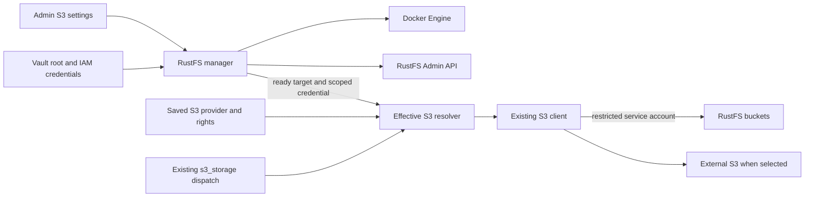

# Managed RustFS S3 integration plan

Status: implemented in the isolated `codex/rustfs-managed-s3` worktree, 2026-10-26; no merge, push or deployment. Three GPT-6.1 Sol agents at Max handled runtime, S3 authorization and administration/UI, with the parent integrating and reviewing their work. This document retains the planning baseline and acceptance requirements; the closeout below records verified coverage and remaining platform checks. Operation instructions are in [Managed RustFS](../documentation/rustfs.md).

## Objective and scope

AuraGo manages one optional RustFS server in Docker. An administrator installs and operates it from the existing S3 settings. Once provisioned, **Managed RustFS** becomes a selectable provider for the existing `s3_storage` tool. Agent access is separately enabled and constrained by operations, buckets and object-key prefixes, enforced both in AuraGo and RustFS IAM.

Reuse the installed MinIO Go client and the existing S3 schema. Add a small RustFS lifecycle and administration package using the existing Docker transport and AWS SigV4 signer. Do not replace the S3 client, introduce a second storage tool, or build a generic provider/plugin framework.

First version: one managed instance, one node, one data volume, one active S3 provider. Preserve external S3 settings and credentials when switching providers. Virtual Computers' managed Garage remains independent. Clustering, automatic data migration, S3 File Manager mounts, public sharing/presigned URLs, bucket deletion and automatic upgrades are outside this version.

## Existing source and integration points

The inspected checkout was `main` at `d4657d30ddb032013cb096888efac9e5cba0f922`, with unrelated working-tree changes. Implementation must inspect its own checkout again. The GitNexus graph was 108 commits behind and partial; an index-only rebuild failed on filesystem permissions. Current-source reads and Graft were used to verify the relevant paths. Graph results are not complete impact evidence.

| Existing owner | Current behavior and required work |
| --- | --- |
| `internal/config/config_types.go:1861`, `config_template.yaml:731` | One S3 endpoint, default bucket, Vault keys, enable and readonly flags. Add an optional provider selector plus separate RustFS settings; omitted provider remains external. |
| `internal/tools/s3.go:76`, `:104` | Installed `minio-go/v7` client and existing S3 dispatcher. Resolve the selected provider and enforce effective permissions in the leaf execution path. |
| `internal/agent/agent_dispatch_services.go:1559`, `tool_args_services.go:313` | Production `s3_storage`/`s3` dispatch, including native and `Params` arguments. Preserve aliases and argument compatibility. |
| `internal/agent/native_tools_content.go:105`, `tooling_policy.go:455` | Existing seven-operation schema and availability. Keep the schema; make discovery and execution respect managed readiness and agent access. |
| `internal/agent/live_tool_authorization.go:37`, `action_policy_targets.go:278` | Permission intersection does not automatically fence provider/endpoint changes; S3 targets are currently generic. Add target/generation fencing and concrete source/bucket/key identities. |
| `internal/tools/integration_connection_checks.go:102`, `internal/server/integration_test_handlers.go:171`, `self_test_probes.go:21` | Saved S3 probe currently requires manual keys and HEAD bucket. Use the same resolved provider and a permission-compatible read-only probe. |
| `ui/js/config/main.js:1644`, `integration_actions.js:42`, `catalog.js:45` | S3 is schema-rendered; no provider selector exists. A small S3 section module can add lifecycle and rights controls while retaining shared draft/save/test behavior. |
| `internal/server/dashboard_integrations.go:53`, `ui/js/dashboard/sections/system.js:146` | Integration flags indicate configuration, not health. Add separate observed RustFS state without equating enabled with ready. |
| `internal/dockerutil/managed_resources.go:81`, `client.go:23` | Reuse ownership labels and negotiated Engine transport. Extend managed-resource protection for RustFS. |
| `internal/tools/ollama_reconcile.go:77`, `ollama_network.go:18` | Reuse ownership checks, placement proof, per-Engine serialization, generation cancellation and uncertain-outcome handling as patterns. |
| `internal/localllm/docker.go:277`, `:321` | Existing private credential-volume seeding through the Engine archive API avoids secrets in environment values or host bind paths. |
| `internal/server/server.go:504`, `decisions.go:104` | Integrate reconfiguration at shared config publication; revoke immediately and reconcile outside `CfgMu`. Bind jobs and cleanup to server lifetime. |
| `internal/config/config_migrate.go:907`, `internal/server/config_handlers_main.go:2435`, `internal/tools/python_secrets.go:42` | Preserve external S3 Vault mapping. Add separately reserved and hidden RustFS credentials and export exclusions. |

## Upstream baseline and qualification

RustFS **1.0.4**, released 2026-10-25, is marked stable by upstream and uses Apache-2.0. The tag resolves to `46337942d55f3a8e6a97b147ca98d9ea8115555d`. This establishes the research baseline, not operational acceptance. Recheck advisories and tag/digest identity when implementation starts. [Release](https://github.com/rustfs/rustfs/releases/tag/1.0.4), [license](https://github.com/rustfs/rustfs/blob/1.0.4/LICENSE).

Candidate immutable image:

```text
docker.io/rustfs/rustfs:1.0.4@sha256:ed9210d6411d77ffceb70d94b964a3cb7d225983368bc25bebe01e995293dcc2
```

Public registry metadata includes Linux amd64 (`sha256:e287e99762a4a3e7b706526e01f2ff755f67db165e9be9f6b907adc6fb6d6ee1`) and arm64 (`sha256:6be0def183a9ec8c05147594ac71c030648fcb0a4b79f29f74cebd1d128ba17a`). Both require actual runtime qualification. [Registry metadata](https://hub.docker.com/v2/repositories/rustfs/rustfs/tags/1.0.4), [publish workflow](https://github.com/rustfs/rustfs/blob/1.0.4/.github/workflows/docker.yml#L71).

Verified upstream contracts:

- Container UID/GID is `10001:10001`; persist `/data`. Root credentials can be supplied through `RUSTFS_ACCESS_KEY_FILE` and `RUSTFS_SECRET_KEY_FILE`. Missing credentials otherwise permit known defaults: AuraGo must refuse startup without its own persisted credentials. [Dockerfile](https://github.com/rustfs/rustfs/blob/1.0.4/Dockerfile#L120), [entrypoint](https://github.com/rustfs/rustfs/blob/1.0.4/entrypoint.sh#L121), [credentials](https://docs.rustfs.com/en/operations/credentials).
- Port 9000 serves S3 and the Admin API; 9001 is the Console. Use `/health/ready` for readiness and `RUSTFS_CONSOLE_ENABLE=false` initially. Container running is not S3 readiness. [Health contract](https://docs.rustfs.com/en/operations/status-check).
- Native `/rustfs/admin/v3/` uses JSON plus AWS SigV4 with service `s3`. Only the MinIO-compatible admin prefix adds payload encryption. Use `net/http` and the already-installed AWS v4 signer; do not assume `madmin-go` compatibility. [Payload handling](https://github.com/rustfs/rustfs/blob/1.0.4/rustfs/src/admin/utils.rs#L32), [official client](https://github.com/rustfs/rustfs/blob/1.0.4/crates/madmin/src/client.rs#L583), [signer](https://github.com/rustfs/rustfs/blob/1.0.4/crates/signer/src/request_signature_v4.rs#L635).
- Use path-style S3 and an explicit region. Qualify the actual installed MinIO client against the selected RustFS image, including multipart upload, copy, pagination, checksums and error behavior. Upstream AWS SDK examples do not prove those paths. [Go guide](https://docs.rustfs.com/en/developer/sdk/go), [compatibility matrix](https://github.com/rustfs/rustfs/blob/1.0.4/docs/architecture/s3-compatibility-matrix.md#L21).
- Single-node single-drive storage cannot grow in place into multiple drives/pools. Updates require a consistent backup and tested restoration; automatic binary downgrade is not a storage rollback. [Topology](https://github.com/rustfs/rustfs/blob/1.0.4/README.md#quickstart), [container upgrades](https://docs.rustfs.com/en/operations/upgrade/container).

## Architecture and configuration



Proposed configuration contract, with final Go types frozen before parallel coding:

```yaml
s3:
  enabled: false
  provider: external  # external | rustfs; omitted means external
  readonly: true      # remains an overriding restriction
  # Existing endpoint, region, bucket and transport fields remain external settings.
  # Existing external credentials remain in their existing Vault slots.

rustfs:
  enabled: false
  bucket: aurago      # default managed bucket, created only by explicit setup
  agent_access: false
  permissions:
    allow_read: false
    allow_write: false
    allow_delete: false
    allowed_locations: []  # entries: {bucket: aurago, prefixes: ["agent/"]}
```

The example does not change legacy S3 defaults. Existing external configurations retain their current effective `readonly` value and credentials. New RustFS access is deny-by-default regardless of legacy S3 permissions. No new root or machine secret is serialized in YAML, returned through generic config or editable through a generic Vault route.

Use one canonical typed permission contract for dispatch checks and IAM generation. `Permissions` and `AllowedLocations` naming must cooperate with existing live-authorization intersection; do not assume reflection alone handles target identity or collection semantics.

The managed image, container identity and volume identity are implementation-owned constants/state. Do not expose arbitrary image, environment, command or bind-mount editors. Use existing resource-limit conventions, with values validated against the pinned runtime during qualification.

An internal resolver returns the effective S3 target, scoped credential, policy and target generation. External mode preserves the current configuration. Managed mode requires the RustFS instance to be provisioned and ready, the S3 integration enabled, and agent access enabled for agent callers. Failed managed resolution never falls back to an external endpoint or to root credentials. Admin status/provisioning can operate while agent access is off.

Installing RustFS does not select it automatically. Switching providers changes only the active target; it copies/deletes no objects and preserves the inactive provider's settings. A previously selected but unavailable RustFS provider remains visible with its reason and is rejected at execution.

## Agent permissions and local file boundaries

| Operation | Managed permission and target checks |
| --- | --- |
| `list_buckets` | Read; return only explicitly configured allowed buckets. Do not require account-wide `ListAllMyBuckets`. |
| `list_objects` | Read; allowed bucket and requested prefix. Never enumerate a broader prefix and filter only after receiving objects. Cap the total result across pages and report truncation. |
| `download` | Read on the exact key plus the existing local filesystem-write gate and rooted destination checks. |
| `upload` | Write on the destination key plus protected local input admission. This permission includes overwriting. |
| `copy` | Read on the source and Write on the destination, validating both bucket/prefix pairs. |
| `move` | Copy permissions plus Delete on the source. Preserve existing partial-outcome reporting if deletion fails. |
| `delete` | Delete on the exact key. No recursive bucket deletion or IAM administration. |

`s3.readonly` denies all object mutations even if RustFS permissions allow them. Container lifecycle controls are admin-only and never implied by these data permissions. Do not add presign or claim separate create/overwrite grants; the current tool has neither distinction.

Bucket rules and prefixes are literal and case-sensitive. Empty allowed locations or empty prefix lists grant nothing; `prefixes: [""]` means the whole named bucket and needs an explicit UI choice. `agent/` grants that exact subtree; `agent` is a broader literal prefix and the UI must explain the distinction. Do not URL-decode, case-fold or normalize object keys as filesystem paths. Reject unsupported IAM wildcard/policy-template characters in configured prefixes; escape serialized values normally. Listing an omitted prefix must select a permitted configured prefix or require a choice, never default to an unrestricted bucket scan.

Managed listings stop at a fixed total cap of 1,000 objects or the existing tool-output byte budget, whichever is reached first. `MaxKeys` alone is only a page limit, not a total bound on the client iterator. Cancel/close listing at the cap, return an explicit truncated indicator and advise a narrower prefix; no new configuration or pagination subsystem is required. Apply an equivalent finite output bound to the configured bucket list.

Map only the required S3 actions, including client-required bucket-location and bounded multipart operations. Constrain bucket-list actions with prefix conditions and object actions with exact bucket/prefix resources. Do not grant `s3:*`. Tests must establish that the generated policy and AuraGo checks agree, including copy source and destination and multipart continuation/abort.

Local file handling is part of the integration boundary:

- Managed uploads use `OpenOutgoingAttachment` or the equivalent existing rooted, sensitive-file-protected opener, then upload the retained file handle with `PutObject`. Never validate a path and reopen it through `FPutObject`. Allow the workspace/document output roots supported by that helper; do not grant the whole AuraGo data directory to the new managed mode.
- The legacy external S3 data-directory upload contract is documented in `s3_test.go:91`. Preserve that legacy behavior in this feature; changing its allowed roots requires a separate compatibility decision. Managed-mode restrictions must be explicit in help/tests rather than silently narrowing external backups.
- Downloads retain the same permitted workspace destinations but use the existing rooted atomic writer (`rooted_file.go:144`), finite byte limits, owner cancellation and cleanup. Existing destinations survive truncated/error responses. Reuse established transfer limits instead of creating another unbounded path.
- Add scrubbing to the shared S3 client construction path before network activity, covering both the normal tool and connection probes.

Provider, endpoint, bucket-policy and credential-generation changes must fence admitted requests. Cancel affected in-flight work and recheck authorization before each later operation, particularly move deletion and local download publication. A request started against external S3 must never resume against RustFS, or vice versa. A permission reduction takes effect immediately in AuraGo; IAM reconciliation failure leaves access blocked and visibly pending/error. Unrelated config saves must not cancel valid transfers.

## IAM and secret lifecycle

Use three separated authorities: manager root credentials, a dedicated narrowly scoped IAM parent, and a child service account used only by S3 execution. A regular IAM user alone is insufficient because RustFS permits self password changes even when admin actions are denied. The pinned source explicitly denies credential/MFA mutation for service accounts and rejects their STS AssumeRole requests. Some self-information reads remain possible; do not claim every admin-prefix GET is denied. [Account handler](https://github.com/rustfs/rustfs/blob/1.0.4/rustfs/src/admin/handlers/account.rs#L159), [identity restrictions](https://github.com/rustfs/rustfs/blob/1.0.4/rustfs/src/admin/service/caller_identity.rs#L186), [STS restriction](https://github.com/rustfs/rustfs/blob/1.0.4/rustfs/src/admin/handlers/sts.rs#L212).

Bootstrap uses the native policy, user, policy-binding and service-account endpoints. The child is created for the dedicated parent using `targetUser`, never for root. Parent and child must receive only the intended policy. Add explicit `Deny admin:*` and `Deny sts:*` in separate statements: RustFS rejects mixed action families in a statement. Verify the full generated policy against the actual runtime before enabling the provider. [Policy API](https://docs.rustfs.com/en/security-compliance/iam/policies), [service accounts](https://github.com/rustfs/rustfs/blob/1.0.4/rustfs/src/admin/handlers/service_account.rs#L303), [policy parser](https://github.com/rustfs/rustfs/blob/1.0.4/crates/policy/src/policy/statement.rs#L323).

Persist root credentials before container creation and register every secret before sending it to Docker/HTTP. Project root key files into a dedicated private named volume using the existing archive-seeding pattern; the RustFS environment contains only `_FILE` paths. The service-account and parent secrets remain in reserved `rustfs_` Vault records. Never copy any managed secret into external `s3_` slots.

Reserve managed Vault keys against generic reads/writes, secret prompts, Python export, backups that grant new agent visibility, config disclosure and tool results. Do not send them to the browser or agent. Use `security.RegisterSensitive` on every secret read and for returned credentials before any diagnostic can include them. Admin HTTP clients bind the exact managed origin, reject credentialed cross-origin redirects, bound response bodies and use request/manager cancellation. Register new clients in the existing network-client audit inventory.

Bootstrap/reconciliation must survive partial completion: identify the owned instance, bucket, parent, policy and child deterministically; inspect existing state before each mutation; persist recoverable credentials safely. A timeout after a create is an uncertain outcome, not permission to create another identity. Never regenerate root automatically for an existing data volume. Missing/inconsistent Vault state yields recovery-required and leaves data intact.

Persist an installation identity bound to the verified Engine, owned data-volume identity and an initialization marker, not just a volume/container name. If initialized storage disappears or the Engine/volume identity changes, block with recovery-required; never create an empty replacement using the old credentials. Retained runtime-removal/stopped intent belongs to this identity. Treat unexpected loss of a provisioned bucket, parent or child as a recovery condition, not permission to silently rebootstrap.

For rights changes, block affected data admission first, reconcile IAM, verify the resulting scoped credential, then publish the new generation. The effective IAM grants include `s3.enabled`, the selected provider, `s3.readonly` and managed agent access, not just the explicit RustFS operation checkboxes. Turning agent access/S3 off or selecting external S3 disables the managed child; reenabling it requires successful policy reconciliation. Rotation/replacement disables the old child before declaring revocation complete. Do not widen rights temporarily through a root data-client fallback. A delayed or failed IAM change must not be presented as fully applied.

## Docker lifecycle and persistence

Create `internal/rustfs` with a small manager, native admin client, policy generation and focused tests. Reuse `dockerutil.Client`, `ManagedLabels`, existing job/receipt conventions and cancellation patterns. No durable job database or generic sidecar framework is needed.

Reserve `aurago-rustfs`, its credential seed container, and separately labeled data/credential volumes. Inspect owner labels and immutable IDs before changes; a foreign resource with a reserved name is a conflict. Never mount AuraGo's full data volume or recursively change ownership of an arbitrary host path.

1. **Disabled/uninstalled:** no pull, credential generation or resource creation. Saved enablement permits explicit setup; status reads do not install.
2. **Explicit setup:** validate saved settings and Docker gates, prove placement, inspect ownership, ensure the pinned image, prepare owned volumes/private credentials, start nonroot RustFS, wait within a deadline for `/health/ready`, then provision the default bucket and scoped IAM. Keep the child disabled until agent access is enabled and the effective policy is verified. Provisioning remains separate from enabling agent access; comprehensive mutation/denial tests run in disposable acceptance fixtures, not against operator objects during routine startup.
3. **Start existing instance:** verify the retained installation and Engine/volume identity, start the owned runtime, await health, then inspect retained bucket/IAM state and reconcile existing policy generation. Publish readiness only after verification succeeds. Missing initialized state requires recovery; ordinary Start never creates a missing bucket or new identity. Recreate may replace the owned runtime against verified retained storage, but must not reinitialize data. Reuse the stored running/stopped/removed intent across AuraGo restarts and never adopt by name.
4. **Stop/disable:** revoke data admission immediately, cancel pending lifecycle work, request bounded graceful stop and report actual observation. Confirm required stop before publishing a Docker-write revocation; refuse that configuration transition if stop is uncertain. A normal RustFS disable can record desired disabled and report `stop_unconfirmed` while retaining authority for bounded cleanup.
5. **Remove runtime:** remove only the verified owned container. Retain data and credential volumes plus recovery identity. No volume prune, `?v=true`, bucket purge or hidden destructive reset.
6. **Upgrade/recreate:** explicit administrative action using a qualified digest. Verify backup/restore preparation and pull the new image before interrupting the current container. Preserve volumes. Never promise automatic metadata rollback or downgrade safety.
7. **AuraGo shutdown:** cancel and drain manager work and close transports. Leave an established storage container running under `unless-stopped`; explicit Stop/Disable controls its lifetime. Do not restart a manually stopped instance merely because AuraGo restarts.

Serialize lifecycle work and fence it by config/target generation. Administrative config saves that revoke necessary Docker authority need a preparation phase under `CfgSaveMu`, outside `CfgMu`, before YAML persistence: block new admission, cancel/drain affected jobs, confirm the required stop, then persist and publish. Failure rejects that save; retain an honest stopped/unknown runtime state if persistence subsequently fails. Apply this to every administrative save/setup path. Startup or externally loaded configurations have already changed authority: immediately block admission and report `stop_unconfirmed` if cleanup cannot be authorized, rather than claiming their publication was rejected.

The shared `replaceConfigSnapshot` hook performs lightweight runtime publication/revocation and schedules reconciliation outside `CfgMu`; it is not a fallible pre-save transaction. Accepted asynchronous operations survive HTTP disconnect but are cancelled/drained on server shutdown. Classify lost mutation responses as unknown, inspect before deciding, and never replay automatically. Bound logs, pull/probe durations and polling.

Use a read-only root filesystem and finite resource limits where verified compatible; provide only the writable paths required by the selected image, including its chosen log strategy. Keep runtime user 10001 and private key-file modes. The seed helper uses the established nonroot, network-none archive pattern; runtime and seed need separate tested container specifications.

## Placement and access boundaries

| AuraGo placement | Managed RustFS access |
| --- | --- |
| Native process with proven local Docker Engine | Publish API on an available loopback port; use that saved/resolved target. Verify port conflicts before interruption. |
| AuraGo container on the same proven Engine | Join a verified shared application network, preferably internal `aurago-app`; use stable container DNS with no host publication. |
| Remote/unproven Engine or shared/host namespace ambiguity | Reject managed preflight with an actionable reason. An explicitly configured external RustFS endpoint remains possible through external S3. Remote deployment automation is deferred. |

Never select the first network from a map or attach to `docker-control`. Do not guess the S3 host from a socket-proxy/TCP Docker address. RustFS gets no Docker socket or host namespace. Console is disabled and neither Console nor S3/Admin gets public/LAN exposure by default. Adding remote access later requires its own reviewed TLS/origin setup; an HTTP health check is not authorization to expose the admin surface.

Current Compose proxy capabilities already include the required containers/images/networks/volumes/info/version/write operations. Preserve `BUILD=0`; image pull and archive seeding need no Engine build or exec permission. Preflight must report missing capabilities rather than requesting unrestricted Docker access.

Always protect RustFS system resources from generic agent Docker and Compose operations, including with `docker.allow_host_access=true`. Follow Local LLM/Garage/CYD ownership protection, not the weaker generic sidecar-name guard. Cover reserved names, labels, immutable IDs/prefixes, renamed runtime/seed containers, secret/data volumes, aliases/bind sources, archive/copy/exec/logs, `volumes_from`, namespace joins and Compose effective models. Register the owner with administrator container protection as well.

These guards enforce AuraGo's supported tool boundary. An operator who separately grants unsandboxed host/root or direct Docker-daemon access has granted authority beyond the S3 policy; do not present an S3 toggle as containment of those credentials.

## Administrative API and user flow

Keep the entry point in the existing **S3 storage** section (`ui/cfg/s3.js` and the existing module registry), avoiding a second independent storage configuration screen. All copy/help/status text must be translated into all sixteen locales.

1. Show the current provider and retain external fields. Before installation, show a **Set up RustFS** card and a locked provider option with its reason.
2. Save configuration before setup/test/lifecycle actions. Preflight shows Docker availability, placement, retained volumes, storage path/volume identity and intended isolation. It never creates resources.
3. Setup produces an operation receipt and visible progress through image download, container startup, IAM setup and verification. Do not mark ready merely because Docker reports running.
4. After successful provisioning, enable the **Managed RustFS** provider choice. Endpoint/transport are derived and read-only. Switching provider still requires Save and never enables agent access by itself.
5. Show a separate agent-access toggle, operation grants, allowed buckets and literal prefixes. Explain that Write can replace objects and Move requires Delete. Empty grants visibly mean no access.
6. Provide status, read-only connection test, Start, Stop, explicit update/recreate and Remove runtime with a clear data-retention explanation. Reuse existing modal/receipt patterns; no `alert()` and no duplicate mutation admission.
7. Disable lifecycle mutations for dirty drafts, unavailable Docker or Docker/management readonly policy with translated reasons. `s3.readonly` restricts object mutations and must not disable setup/start or administrative observation. Dispose polling on navigation; stale responses must not repaint or attest a changed configuration.

Suggested routes: `GET /api/rustfs/status`, `POST /api/rustfs/preflight`, `POST /api/rustfs/install`, `/start`, `/stop`, `/recreate`, `/remove`, and `GET /api/rustfs/operations/{id}`. Use the existing S3 test route for the selected data provider; add only a separate manager test if lifecycle diagnostics need a distinct contract. These route names are proposed, not existing endpoints.

All management routes require admin, strict methods, bounded input, `no-store`, same-origin browser mutation checks and current config/Docker admission. Long actions return accepted receipts, concurrent conflicting actions return a stable busy response. Status is passive and sanitized. No caller-supplied endpoint/image/command/credential bypass is accepted.

Keep `integration_actions.js` and `catalog.js` mode-aware: RustFS does not need manually entered external S3 keys. A prefix-restricted service account can legitimately reject HEAD bucket. For readable policies, test a permitted prefix with a bounded listing; for write-only/deny-all policies distinguish runtime ready from data-read verification unavailable. The existing connection test never creates or deletes a bucket/object. Self-test probes must retain the same saved-config and read-only behavior.

Dashboard shows configured provider plus separate observed lifecycle/data-access status. Important distinctions: disabled, not installed, installing, ready, stopped, permission pending/denied, unavailable Docker, unsupported placement, foreign resource, recovery required and uncertain mutation outcome. Do not turn these into a new generic status framework.

## Implementation waves and ownership

Use **GPT-6.1 Sol, reasoning Max** for every implementation/review subagent, as requested for this task. The parent remains orchestrator and final control authority. Use one clean task worktree, inspect existing attachments first, and keep workers on disjoint files. They must not revert other workers' or pre-existing changes. No implementation, push, deployment or data migration is authorized merely by this planning document.

| Wave | Owner | Deliverable and boundaries |
| --- | --- | --- |
| 0 | Orchestrator with RustFS research/proof worker | Freeze config types, permission semantics, resolver/manager boundary, error/receipt contracts and candidate image. Land the minimal compilable shared Go types and test seams before dependent wave-1 workers start; they must not invent competing substitute types. Prove native SigV4 JSON bootstrap and scoped child-account denials against an isolated disposable instance before committing to the integration. No production data. |
| 1A | Runtime worker | Own new `internal/rustfs` manager/admin/policy/credential/network files and their tests. Implement retained volumes, bootstrap, IAM reconciliation and lifecycle. Consume the frozen config contract. |
| 1B | S3 and authorization worker | Own `internal/tools/s3*`, relevant S3 probe helpers, `internal/agent` S3 dispatch/discovery/live authorization/action targets and tests, and S3 manual/schema descriptions. Use the runtime snapshot contract; do not alter worker A's package internals or shared config files. |
| 1C | Admin UI worker | Own new `internal/server/rustfs_handlers.go` and focused handler tests, `ui/cfg/s3.js`, related UI tests and locale/help additions. Use fixed route/receipt contracts. Do not edit central startup/config/router files concurrently. |
| 2 | Orchestrator | Own shared config/template/Vault plumbing, server startup/publication/routes, Docker/Compose resource-protection registration, dashboard/shared UI registries, network audit entries, documentation/DOX indexes and integration. Delegate bounded edits only after transferring exclusive file ownership. |
| 3 | Reviewers with changed ownership | Runtime worker reviews S3/IAM denial; S3 worker reviews lifecycle/data retention; UI worker verifies complete saved-config/browser flows. Reviewers report independent findings without silently rewriting another worker's scope. |
| 4 | Orchestrator | Resolve findings, inspect the final diff, run focused/cross-component checks, review live acceptance evidence, perform DOX closeout and commit intended changes locally. Treat skipped environment acceptance as open, not passed. |

No worker decides its own acceptance. The orchestrator checks evidence at each boundary, resolves interface changes before coding continues, and serializes shared-file changes. A passing unit suite cannot waive failed IAM, data-retention, secret-disclosure or live-generation tests.

## Verification and acceptance

| Area | Required evidence |
| --- | --- |
| Config compatibility | Omitted provider remains external; keys and inactive settings survive switches/restart; managed defaults deny; invalid provider/prefix fails; absent Runtime/Vault does not enable a fallback; config/setup/save paths agree. |
| Permission matrix | Every operation against read/write/delete combinations, readonly and agent-access off; forbidden bucket, prefix boundary and both copy/move ends; literal Unicode/encoded/wildcard inputs; omitted prefix with one/multiple/empty grants and explicit whole-bucket access; no account-wide bucket leakage; multipart behavior. Multiple-page listing fixtures prove the total count/byte cap, truncation and cancellation. |
| Live authority | Alias/native/wrapped calls use the same leaf checks; provider A-to-B-to-A, IAM rotation and policy reductions fence stale work; unrelated saves preserve it; move never deletes after revocation; local publication stops after authority loss. |
| IAM integration | Root provisions scoped parent/child with the native API. Child performs allowed S3 actions and cannot access other prefixes/buckets, change policy/users, create service accounts, change parent credentials/MFA or use STS. Retest an already-issued child credential directly after agent-access/S3 off, provider switch, S3 readonly, each operation reduction and prefix/bucket removal; do not test only local denial with a newly issued key. Verify reenable/rotation and no root fallback. |
| Secrets and files | No secrets in config/status/receipts/logs/tool output/container env/arguments/labels; Vault and Python exclusions; bootstrap interruption/recovery; rooted upload symlink/hard-link/sensitive-file denial; bounded atomic download and cancellation; legacy external upload compatibility. |
| Docker lifecycle | Disabled has no side effects; foreign resources untouched; image pull failure leaves current runtime; duplicate/cancelled jobs; network failures after mutations produce inspection/unknown state; stop/restart/remove-runtime/update preserve objects and identity; no normal volume-delete requests. Pre-save authority revocation stops before persistence; failed stop rejects save, while already-loaded revoked config reports blocked/unknown honestly. |
| Placement/proxy | Native local and container-internal network paths, rejected Docker-control and remote ambiguity, no public bindings, nonroot/file ownership and resource limits; works with existing proxy and `BUILD=0`, without exec or socket bypass. |
| Generic tool bypass | Name/label/ID/renamed resource protection, seed/runtime inspect/archive/exec/logs, volume mounts and host paths, Compose aliases/namespace references and host-access override. |
| Admin/browser | Non-admin, CSRF, wrong methods, body bounds, dirty draft locks, saved provider-aware probes, duplicate submission, receipt polling/navigation, provider switch with preserved drafts, sixteen genuine translations, responsive keyboard-accessible UI. |
| Persistence and recovery | Real object survives AuraGo restart, container restart, runtime removal/recreation and qualified upgrade; restore from a consistent backup including IAM/Vault recovery inputs. Missing initialized volume, changed Engine, missing credentials or removed bucket/IAM state never trigger empty-store bootstrap. Start/status do not recreate a deleted bucket; removed runtime does not reappear on process restart. |

Existing focused suites to retain include `TestCheckS3ConnectionUsesHeadBucket` for external mode, `TestS3ResolveUploadSourceAllowsOnlyWorkspaceOrData` for legacy mode, S3 atomic-download tests, generic integration-test registry/locale tests, config secret/write-protection tests and Docker managed-resource/Compose regressions. Add meaningful new RustFS tests beside their owning code, not duplicated tests of trivial wiring.

Run focused packages `internal/rustfs`, `internal/config`, `internal/tools`, `internal/agent`, `internal/server`, `internal/dockerutil`, `internal/security`, `internal/audit` and affected `ui` tests. Run `node --check` on edited JavaScript, parse changed locale JSON, and use existing browser fixtures. Run race checks for lifecycle/publication on supported Linux. Use the repository test wrapper if scratch Go files exist. Repackage/check external web assets when UI changes require it; no release or server rollout is implied.

Real acceptance requires separate evidence for Linux amd64, Linux arm64 and Windows Docker Desktop with Linux containers. Cover native AuraGo and containerized AuraGo with the socket proxy. Rootless Docker is an explicit qualification case, not an inferred guarantee. Missing hardware/daemon access stays documented as unverified.

Release gates, in order:

1. Exact image and native IAM protocol work with the selected clients; machine privilege denials pass.
2. Local and RustFS permission checks agree and cannot be bypassed through managed resources or stale runs.
3. Stop/remove/recreate and recovery preserve data, credentials and ownership; uncertain outcomes are honest.
4. Existing external S3/other managed integrations pass regression checks.
5. Complete admin UX, translations, docs and supported-platform acceptance are reviewed by the orchestrator.

## DOX and delivery

Implementation creates `internal/rustfs/AGENTS.md` in the required section order and adds RustFS to the root routing index. Update affected `internal/tools`, `internal/agent`, `internal/server`, `internal/security` and `ui` owners for the new contracts. Update `internal/dockerutil` guidance only if its shared contract changes. Garage's guide remains unchanged because its ownership and objects are unaffected.

Add an English RustFS operator guide covering setup, permissions, provider switching, data retention, backup/restore, topology limits, lifecycle failures and supported placement. Update the S3 manual, relevant agent prompts/descriptions, `config_template.yaml`, Docker installation notes, dependency/image documentation and all relevant UI help. Record RustFS and its license in the existing third-party inventory following `licences/AGENTS.md`.

Review the `agotrain` tier/operation contracts and DE/EN coverage under `documentation/training.md`. No new S3 tool/operation is planned, but source-aware availability and permission outcomes still need matching curated semantics; do not blindly regenerate unchanged manifests.

## Implementation closeout

- Added the private RustFS manager, scoped native IAM, existing-tool provider resolution, generation fencing, Docker/Compose resource protection, administrative receipts, S3 settings and all sixteen translations. Runtime is optional and disabled by default; removal retains both volumes.
- Reviewed and updated root, runtime, agent, tools, Docker utilities, server, self-test and UI contracts. Security primitives, licensing workflow and Garage ownership remain unchanged, so their guides need no new rules. Operator, Docker installation, dependency, tool-manual and license documentation are aligned.
- Compatible training pack: local agotrain commit `8eb5c9ab6c1344e4ee4bd70b03adfc5a50c02ba1`, pinned by `.github/agotrain-revision`. Curated contracts/tiers and scenario identities are unchanged. Both exporter checks, independent dataset validation, Go contract checks and Python offline/lock checks passed. Publish that commit before publishing the dependent AuraGo branch; no automatic cross-repository push occurred.
- Source review closed prepared-save admission races, durable-versus-aborted save authority, uncertain rollback, inactive-provider Docker-target drift, mutation retries and missing initialized-volume recovery. GitNexus remained partial; direct source review and executable checks supply the missing evidence.

| Verification | Result |
| --- | --- |
| Focused RustFS/S3, Docker/Compose and agent authorization regressions | Passed. |
| Full server, config, Docker utility, security, Vault prompt and audit packages | Passed; final save-boundary changes also passed focused regressions. |
| UI contracts, locale checks and actual Chrome configuration/dashboard fixtures | Passed; desktop and narrow-screen screenshots reviewed. |
| Native Windows AuraGo client with Docker Desktop Linux amd64 RustFS | Passed isolated live IAM, S3/multipart/copy/delete, revocation, restart, retention and recovery gates. |
| Containerized Linux amd64 through the existing pinned socket proxy | Passed the live gate with `BUILD=0`, `EXEC=0`, private control/application networks and no public S3 binding. |
| Windows and Linux arm64 backend compilation | Passed; compilation is not hardware qualification. |
| Version-bound web resources | Full asset package passed; the final Windows binary verified the matching installed resource set with `--check-assets`. |
| Full tools/agent packages | Two unrelated isolation test families fail on both this branch and clean starting commit `d4657d30ddb032013cb096888efac9e5cba0f922`: `TestCrawlerResultWithRawTitleIsIsolatedByGuardian` and `TestExecutionOutputIsolationSurvivesVaultAndCompression`. |
| Remaining acceptance | Physical ARM64, native Linux/rootless placement, Linux race/symlink execution, backup restoration, upgrades to another image, sustained load and production deployment remain unverified. Native TCP Engine placement is deliberately refused without local proof. |
