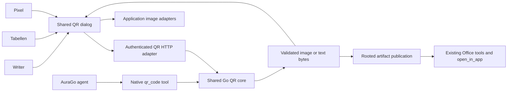

# Shared QR code module implementation plan

Status: implemented, 2026-10-26. The shared core, Desktop/agent interfaces and three editor adapters are present. Current operating contracts, limits and verification commands are in [documentation/qr-code.md](../documentation/qr-code.md). Real camera/printed-page acceptance remains separate from the automated software checks.

Build one QR module for Writer, Tabellen, Pixel and the AuraGo agent. Cover the functional Mini QR baseline below, including scanning and batch export. Implement with `gpt-6.1-sol`, reasoning effort `max`, under the coordinating agent's review. This task-specific model choice overrides the general Luna preference for the implementation workers; it does not change unrelated tasks.

## Product scope and upstream baseline

The reference is [Mini QR](https://github.com/lyqht/mini-qr/tree/fe46504853c597e44b2e39d3decb5df2184c6605), commit `fe46504853c597e44b2e39d3decb5df2184c6605`, whose package version is `0.30.2`. Pin acceptance to this revision, rather than promising parity with future upstream changes. The feature list comes from its [README](https://github.com/lyqht/mini-qr/blob/fe46504853c597e44b2e39d3decb5df2184c6605/README.md); the detailed controls below are grounded in the linked source files.

| Area | Required behavior in AuraGo | Acceptance |
| --- | --- | --- |
| Content templates | Text, URL, email including subject/body/CC/BCC, telephone, SMS, WiFi including hidden networks, vCard, location, calendar event, EPC SEPA/GiroCode | Each template generates a decodable payload with correct escaping. UTF-8 survives byte-for-byte, including umlauts, CJK, Arabic and emoji. |
| Template details | vCard 2.1/3.0/4.0, WiFi open/WEP/WPA, calendar date/time handling, EPC versions 001/002 | Validate against the relevant published formats; include timezone, delimiter and line-injection cases. Never initiate a payment, call, connection or calendar import while generating or scanning. |
| QR appearance | Separate module, finder-outline and finder-center colors; background/alpha; size; quiet zone; rounded outer background | Preview and exports use the same layout and preserve a square QR matrix inside rectangular framed output. |
| Shapes | Modules: square, rounded, extra-rounded, classy, classy-rounded, dots. Finder outlines: square, rounded, extra-rounded, dot. Centers: square, rounded, dot | Every selectable shape renders in raster and vector exports and passes the reference scan fixtures. |
| Logos | Upload/select an image or explicitly import an image URL; logo size, margin and hide-background-modules control | Normalize inputs, embed image bytes in exports, retain no external references. Reject unsafe or unsupported image content explicitly. |
| Frames | Text above/below/left/right; multiline captions; side-caption width; text/background/border colors; border width/radius; padding; font selection; background image | Frame layout survives all export formats, with a local font catalog and no web-font requests. |
| Presets and randomization | Original AuraGo presets, frame presets, bounded random style selection, save/load configuration, JSON import/export | Preserve selected payload independently of style changes. Reproduce an exported configuration, including imported logo/background bytes. |
| Simple and full controls | Compact default view, full settings, selectable controls pinned into the simple view | Switching views never changes the QR configuration. Keyboard and screen-reader use remain possible. |
| Error correction | L/M/Q/H selection, size/capacity feedback, logo/contrast/quiet-zone warnings | Never silently truncate payloads or change a requested correction level. Apply template-specific constraints explicitly. |
| File and clipboard output | PNG, JPEG, SVG; copy image; ASCII, Unicode full-block and half-block; TXT and fenced Markdown text output; copy text | Decode the final raster bytes, test SVG rasterization separately, flatten JPEG alpha against an explicit background, and provide a download fallback when clipboard APIs are unavailable. Text output represents the QR matrix, without logo or frame artwork. |
| Batch | CSV upload and templates for text/URL and vCards; per-row caption, filename and frame font; preview; ZIP export | Quoted fields and multiline captions parse correctly; validate rows before publication, generate collision-free safe names, report row errors, and support cancellation. No silent row drops. |
| Scanner | Camera, image upload, drag/drop and clipboard input; classify supported payloads; show/copy results | Camera permission follows a user action, all tracks stop on close, and recognized content never executes automatically. Agent scanning uses files, not an unsolicited camera capture. |
| Themes and language | Existing AuraGo themes and all 16 application locales | Real translations, German Du/umlauts, scoped dialog styles, responsive controls, focus restoration and accessible labels. |
| PWA and local operation | Use AuraGo's existing installed application shell and versioned asset delivery | Generation and scanning require no external service. A reachable AuraGo backend remains required; a second standalone PWA, Mini QR's 30+ language catalog and operation after disconnecting from AuraGo are host-product differences, not claimed parity. |

Detailed upstream references: [payload templates](https://github.com/lyqht/mini-qr/blob/fe46504853c597e44b2e39d3decb5df2184c6605/src/utils/dataEncoding.ts), [rendering options](https://github.com/lyqht/mini-qr/blob/fe46504853c597e44b2e39d3decb5df2184c6605/src/lib/qr-code/types.ts), [frame controls](https://github.com/lyqht/mini-qr/blob/fe46504853c597e44b2e39d3decb5df2184c6605/src/utils/framePresets.ts), [simple view](https://github.com/lyqht/mini-qr/blob/fe46504853c597e44b2e39d3decb5df2184c6605/src/utils/simpleModeFields.ts), [text export](https://github.com/lyqht/mini-qr/blob/fe46504853c597e44b2e39d3decb5df2184c6605/src/lib/qr-code/ascii-export.ts), [CSV processing](https://github.com/lyqht/mini-qr/blob/fe46504853c597e44b2e39d3decb5df2184c6605/src/utils/csvBatchProcessing.ts), [scanner](https://github.com/lyqht/mini-qr/blob/fe46504853c597e44b2e39d3decb5df2184c6605/src/components/QRCodeScan.vue).

## Architecture decision

Use a native, CGO-free Go core in `internal/qrcode`, an authenticated HTTP adapter, a native agent tool and one lazily loaded Vanilla JavaScript dialog. Browser and agent call the same encoder, layout, renderer, decoder and validators. This makes agent generation work without a desktop window, browser process, Node runtime, Python, Docker or a cloud QR service.



The browser requests a debounced preview and discards superseded responses. Export and insertion bind to the exact configuration revision shown in the preview; an old response cannot insert into a different document. Previews are transient and never write files. No QR content goes into query parameters.

Mini QR is [GPLv3](https://github.com/lyqht/mini-qr/blob/fe46504853c597e44b2e39d3decb5df2184c6605/LICENSE); AuraGo's root `LICENSE` is MIT. Use Mini QR as a behavior reference and implement against public data formats with permissive dependencies. Do not vendor its application, renderer, presets, translations or branded artwork under an MIT label. A direct GPL integration would require a separate licensing/distribution decision.

The first dependency candidate is [gozxing](https://github.com/makiuchi-d/gozxing), which documents pure-Go QR encoding and decoding. Its [license file](https://github.com/makiuchi-d/gozxing/blob/master/LICENSE) contains the Go port's MIT notice and upstream ZXing Apache-2.0 terms; retain both. Pin a reviewed release only after the feasibility checks below. Reuse the existing `golang.org/x/image` dependency for image/font work where sufficient. Do not hand-write QR error-correction coding or introduce a general graphics framework merely for this feature.

Use one layout representation for both SVG and raster drawing. It must describe neighboring-module geometry, finder shapes, image placement and caption layout so exports cannot drift. SVG output contains generated geometry and embedded vetted images/fonts or glyph paths, with no scripts, external resources or foreign HTML. A text-shaping dependency is justified only if the font/RTL proof demonstrates that existing facilities cannot meet the accepted caption behavior.

Browser-only JavaScript plus headless Chromium would add an optional runtime to agent calls. A Go/WASM build could enable disconnected browser rendering later, but is outside this initial server-backed integration. Neither is necessary for the stated app and agent workflows.

## Existing integration points and gaps

Source baseline: working tree at `f34d946fd`; unrelated edits exist. Re-read current source and the DOX chain before implementation. The queried GitNexus index was partial and 107 commits behind its checkout; source anchors below were checked directly and are not a complete graph impact report.

| Owner | Reuse | Work required |
| --- | --- | --- |
| `ui/js/desktop/apps/writer.js`, `insertImage` | Native image command, document revision check, PNG/JPEG/WebP support | Add Insert QR entry and pass generated PNG through this path. Capture/restore the document selection, use physical insertion dimensions independently of export pixel resolution, retain read-only and suggestion-mode restrictions. |
| `writer-session.js`, `writer-panels.js` | Serial autosave, recovery, print/export of current editor state | Verify inserted media survives DOCX save/reopen, undo/redo, recovery, print and export. Avoid a second save path. |
| `sheets.js`, `scripts/sheets-actions.js`, `sheets-charts.js` | Univer instance, native undo commands, auxiliary object and chart positioning patterns | Add QR image objects anchored to a cell. The inspected app does not install the Univer drawing preset and has no image insertion flow. Prove the smallest OSS solution before selecting a native drawing package or an overlay using the existing command bridge. |
| `internal/office/workbook_editor.go`, `internal/server/desktop_sheets_handlers.go` | Typed editor snapshots, structural journal, conditional native XLSX writes, preservation of opaque parts | Persist real drawing/media relationships and restore image positions. Extend only the image representation needed for QR; preserve existing drawings/charts/macros and reject changes whose references cannot be retained. |
| `pixel-layers.js`, `pixel-core.js`, `pixel-stickers.js`, `pixel-ora.js` | Layer creation, revision fencing, pixel commits, transforms, history and OpenRaster persistence | Add `pixel-qrcode.js` through the module registry. Insert into a new named raster layer, commit once, preserve other layers and selection state. Size/position is chosen before insertion; later movement uses existing tools. |
| `ui/js/desktop/shared/`, `core/module-loader.js` | Shared picker/dialog patterns and versioned lazy loading | Add `qr-dialog.js` and `ui/css/desktop-qr.css`; one dialog implementation, owned by its initiating window. Dispose requests, URLs, timers, camera streams and listeners on close. |
| `internal/tools/office_tools.go`, `native_tools_integrations.go`, `agent_dispatch_comm.go` | Existing `office_document`, `office_workbook`, Desktop service and `open_in_app` | Existing operations have no `insert_image`. Add a narrow package-preserving insertion operation to both Office tools for agent QR workflows; never route rich documents through the reduced legacy write model. |
| `ui/js/vendor/qrcode.min.js` and existing callers | Existing small QR displays, including MeshCore | Leave those consumers in place. Replacing unrelated authentication/device QR paths is outside this change. |

Writer is currently pinned by its vendor manifest to core 2.29.0; the Sheets build script and package manifest pin Univer 1.0.4. `internal/office/AGENTS.md` still lists older versions. Reconcile those specific entries with the owning manifests during the Office implementation DOX pass; do not perform a dependency upgrade as part of QR integration.

## Shared input and output contracts

Define a versioned `QRSpec` with typed content, style, logo, frame and output settings. The raw text template supports an already serialized payload. Each other template uses its own validated fields; a structured payload and conflicting raw payload cannot both be supplied. Unknown options, invalid numbers and over-capacity payloads fail explicitly.

Keep the first schema compact: `schema_version`, `content`, `style`, `logo`, `frame`, `output`. Separate payload from style so presets can be reused without copying WiFi passwords or contact data. Persist only presentation preferences automatically. Saving a full configuration with payload or caption is an explicit save/export action. The `.qr.json` file stores a version and normalized embedded image resources; no live URL is needed to reopen it.

The core accepts bytes and returns bytes plus typed metadata and diagnostics. It neither resolves arbitrary filesystem paths nor publishes files. Adapters own permissions, resource imports and file writes. Proposed HTTP surface:

| Route | Responsibility |
| --- | --- |
| `GET /api/qr/presets` | Bounded catalog of supported templates, shapes, local fonts and original presets. |
| `POST /api/qr/render` | Validate and return one PNG/JPEG/SVG/text result; preview uses the same service without publication. |
| `POST /api/qr/scan` | Decode bounded image bytes and classify the payload; no persistence. Camera fallback uses sampled frames with at most one in flight. |
| `POST /api/qr/batch` | Validate CSV, produce a bounded ZIP or a row-error report; cancel on disconnect. |
| `POST /api/qr/import-image` | Explicit guarded URL import when requested; no fetching during rendering. Reuse an existing suitable import route instead if the implementation inventory finds one. |

Apply the existing owner/session, CSRF, HTTP timeout and permission middleware. Responses containing payloads or previews use `Cache-Control: no-store`; generated files use the existing authenticated/signed media routes. New routes must enter the same security classification tests as other Desktop handlers.

Proposed initial resource ceilings are 4096 by 4096 total output pixels, 10 MiB per uploaded image/config resource, 32 megapixels per decoded input image, 5 MiB CSV input, 500 batch rows and 128 MiB total batch output. Check dimensions before decoding and all encoded/decoded allocations before work; use serial batch rendering and bounded concurrent admission. These are implementation guardrails to validate in phase 0, not measured performance claims. QR capacity is determined by the selected encoding and correction level, not just the generic request limit.

## Agent contract

Expose one discoverable native tool, `qr_code`, with these operations:

| Operation | Inputs | Result and effects |
| --- | --- | --- |
| `presets` | Optional category | Supported data types/styles and bounded metadata. Read-only. |
| `generate` | Typed content and style, or an authorized saved config; output format and destination | Publish a validated artifact. Return workspace-relative path, MIME, dimensions, verification status and permitted preview/download reference. Optional explicit config export. No base64 image in model context. |
| `batch_generate` | Authorized CSV path, shared style/config, ZIP destination | Return archive reference and counts; report row failures before publication. Never silently publish an incomplete batch. |
| `scan` | Authorized image path | Return typed detected content as isolated external data, with bounded diagnostics. No browser automation or automatic action on decoded URLs/WiFi/payment data. |

Generation supports all styles and templates available to the UI. The LLM chooses structured options; it never draws the QR matrix or uses image generation for machine-readable symbols. A generated artifact is success only after rendering, byte verification and atomic publication succeed. A software decode check is not a claim that every phone or printer will scan the code.

Use existing Desktop-rooted operations for Desktop paths and the existing agent workspace jail for agent-workspace paths. Return opaque artifact references or workspace-relative paths, never host paths. New outputs are create-only by default; replacing an existing artifact requires the existing conditional/version checks. Revalidate operation grants on execution, not just during tool discovery.

Provide `tools.qr_code.enabled` and `readonly` using the existing tool conventions. Default agent exposure off; read-only mode permits `presets` and `scan` but blocks artifact/config publication. Rendering in an explicitly opened human editor remains governed by that editor's capability and read-only state. Network image import separately requires the existing network permission. Native image insertion also requires the respective Office tool and Desktop write permissions; QR enablement cannot bypass them.

Agent examples to cover in native-tool tests and training:

- Generate a WiFi QR image with a German caption and save it under Pictures.
- Generate a styled URL QR, then call `office_document.insert_image` for a DOCX insertion at a defined document anchor.
- Generate a QR and call `office_workbook.insert_image` with sheet and cell anchor; preserve formulas, charts and existing pictures.
- Generate a transparent PNG and open it in Pixel using the existing `open_in_app` path.
- Decode an uploaded QR and report its type without opening the target.
- Produce a ZIP from a supplied CSV, with per-row captions and filenames.

Direct unattended edits to an already open, unsaved Pixel session are not part of the file-based agent contract. Pixel's human Insert QR flow adds a layer to the current document; the agent can create/open a QR image. If automatic modification of existing Pixel projects is subsequently required, add a domain-owned versioned OpenRaster operation instead of controlling the DOM or overwriting an unsaved session.

The Office `insert_image` operations must require a current document/workbook revision and a bounded image reference. For DOCX, add media, relationships, content types and a DrawingML insertion without rewriting unrelated package parts. For XLSX, use the same native image persistence added for Tabellen. Unsupported anchors or packages fail without mutation; an append-at-end DOCX anchor and a sheet/cell XLSX anchor are sufficient initial destinations. Emit the existing file-change events; never claim a file update also changed an unsaved browser document.

Wire the tool through schema generation, feature flags, cache identity, discovery/category/manual lookup, dispatch, operation permissions, action classification, result handling and Tool Bridge exposure where applicable. Update `prompts/tools_manuals/qr_code.md`, the two Office manuals, relevant capability prompts, Config help and all affected locales. Reconcile the strict exported schemas and curated German/English operation coverage in `../agotrain` through [the training workflow](../documentation/training.md), including the pinned dataset check. Do not declare the feature finished while schema/training contracts remain inconsistent.

## User flows and data preservation

All three apps expose **Insert QR code** in their existing insertion/generation menu. The modal has content/template, preview, design and export controls, with the host-specific Insert action. Opening from a selected text or cell may prefill a candidate; it never overwrites that source. Batch work has an explicit preview and ZIP export, with no automatic mass insertion into a document.

- **Writer:** insert a PNG through the existing native image command at the captured selection. A frame may make the image rectangular. Choose document dimensions in points or millimeters; do not use export DPI to insert a page-sized image accidentally. One undo step removes the insertion. DOCX embeds the bytes, so subsequent URL or temporary-file expiry is irrelevant.
- **Tabellen:** insert a persistent image anchored at the selected cell, with aspect ratio, move/resize/delete and native undo. Source-cell prefill is a snapshot; do not add a new volatile `QR()` formula. Sheet rename, row/column operations and Save As must update anchors or explicitly block an unsafe operation. Existing pictures remain preserved, and unknown drawings must not be regenerated or dropped. CSV export remains data-only and discloses that images are absent.
- **Pixel:** add a separate QR layer through `createLayer` and `commitLayerPixels`, respecting document revisions and history. Default to a readable size and keep the full quiet zone within the canvas; offer a larger canvas/size adjustment if it will be clipped. The QR layer is ordinary raster content for the first implementation. ORA preserves that layer; flattened image exports preserve its appearance. A separate saved QR configuration enables regeneration without adding a new parametric layer format.

Store only original, neutral presets; do not copy branded Mini QR logos. Standard scan-safe settings use high contrast and an adequate quiet zone. Low contrast, excessive logo coverage, a tiny module pitch or an unsafe margin produces explicit diagnostics. A failed verification blocks normal insertion/export and offers a safe preset; there is no silent correction or success label for a failed decode.

Arbitrary styling cannot guarantee universal readability. Test the final output at its intended size, and distinguish software verification from actual camera/print acceptance. Changing size, contrast, rotation, cropping or background after insertion can invalidate an earlier scan result.

## Security and privacy checks

- No external QR API, analytics or web-font fetches. Remote logo/background imports are explicit, bounded and use existing SSRF-safe network helpers, redirect checks and network permission; no ambient cookies or credentials. Rendering operates only on already imported bytes.
- Accept known raster formats and only a reviewed, restricted SVG import path. Reject scripts, event handlers, foreign HTML, external references, entities and oversized SVG complexity. Do not send arbitrary SVG to a shell renderer. If no adequate existing sanitizer/rasterizer is available, phase 0 must resolve that capability before claiming logo-format parity.
- Treat decoded QR data, CSV cells, filenames and imported configurations as untrusted. Use text nodes in UI, isolate agent results, validate schemes before offering a link, and never execute formulas, scripts, payment actions or network joins.
- WiFi passwords, contact details and payment fields must not enter diagnostic logs, metrics, URLs or automatic browser storage. A user-saved QR image/config intentionally contains its payload; UI help explains that it is not encrypted. Preserve normal conversation retention semantics rather than claiming the agent's input never exists in history.
- Normalize archive filenames and reject traversal, device names and collisions. Publish through rooted atomic writers only after successful validation/rendering; cancellation cleans temporary files and cannot leave a successful-looking partial output.
- Bound upload bytes, image dimensions, pixel count, QR capacity, JSON depth/fields, CSV rows, archive output, concurrency and time. Do not allocate from attacker-controlled dimensions before preflight.
- Keep data read, artifact create, existing-file change and remote fetch effects distinguishable in policy. Camera/clipboard permissions are human UI actions, never something a model silently grants itself.

## Implementation work packages and supervision

All implementation workers use `model: gpt-6.1-sol`, `reasoning_effort: max`, and a fresh task context carrying this plan and the current owner contracts. Do not start them as part of this planning change. During implementation, the coordinator defines interfaces and owned files, inspects each complete diff, runs independent checks and accepts the phase before dependent work starts. Workers report evidence and limitations; they do not approve their own completion.

Use an isolated managed checkout for implementation because the current main tree has unrelated work. The coordinator owns shared integration files and final commits. Workers must be told that others may edit the repository, must not revert their changes, and must stay within assigned ownership. Parallelize only disjoint app adapters after the core contract is fixed; serialize package manifests, loader, translations, central tool registration and DOX edits.

| Phase | Sol 6.1 Max ownership | Completion evidence reviewed by coordinator |
| --- | --- | --- |
| 0 Feasibility and contracts | Small disposable proof; source inventory; exact dependency/license pins; fixture definitions | Encode/decode UTF-8 and every correction level; prove a logo plus shaped modules plus multilingual frame exports to PNG/JPEG/SVG without native dependencies. Demonstrate a Tables image survives XLSX save/reopen with an existing chart/picture. Validate DOCX image insertion without flattening. Freeze schema, font/import strategy and resource limits. |
| 1 Shared QR core | `internal/qrcode/**`, focused tests and original fixtures; coordinator merges `go.mod`/`go.sum` and notices | All templates, shapes, frames, image inputs, presets, config roundtrip, text exports, decoder and CSV/ZIP behavior pass. Tests use independently decoded final artifacts, not just snapshots of renderer calls. |
| 2 Server and agent | `internal/server/qr_handlers*.go`, `internal/tools/qr_code*.go`; coordinator owns config/agent registration and prompts | UI API and native tool return equivalent results. Disabled/read-only/path/SSRF/CSRF/cancellation/atomic-write tests pass. An agent run produces and scans a QR with no browser running. |
| 3 Shared dialog and app insertion | `shared/qr-dialog.js`, QR CSS, small Writer adapter, `pixel-qrcode.js`; coordinator merges loader/locales | Real browser checks for content/style/export/clipboard/scanner; Writer and Pixel insert, undo, save, reopen and dispose correctly, including stale responses and multiple windows. |
| 4 Tabellen and Office agent insertion | `sheets-images.js` if needed, native command bridge, Office image persistence/DTOs, Office tool operations and tests | XLSX drawings/media persist and preserve other content. DOCX insertion preserves opaque parts. Agent generate-to-Office workflows use conditional writes and the regular event path; conflicts leave originals unchanged. |
| 5 Product verification and delivery | Batch/scanner edge cases, locale coverage, training sync, guide/index updates and packaging | Full feature matrix accounted for; focused suites, packaged-asset smoke, actual camera/print checks recorded separately; coordinator reviews changes, commits intended files and reports any remaining external acceptance gap. |

Phase 0 is a technical decision gate, not permission to ship a reduced black-and-white generator. If pure-Go rendering cannot satisfy an accepted row, present the concrete tradeoff and revised design before implementing an incompatible runtime or silently dropping that row. Keep dependencies stable and pinned; do not upgrade Writer or Univer to make an unproven integration easier.

## Verification and completion criteria

Before editing any existing function, run the required graph impact analysis and confirm dynamic callers in source. Refresh the index when appropriate; empty/partial results are not evidence of safety. Test only intended changes and preserve unrelated dirty files.

| Layer | Required checks |
| --- | --- |
| Core | Table-driven payload and roundtrip tests; capacity/escaping/Unicode/EPC decimal and checksum cases; style/shape/logo/frame fixtures; all four correction levels; malformed input and cancellation. Fuzz config, payload parsers and bounded CSV handling. |
| Renderer | Decode exact exported PNG/JPEG pixels; independently rasterize and decode SVG; compare layout bounds across formats; test transparent backgrounds, long captions and local-font fallback. Include a decoder independent of the encoder for acceptance rather than relying exclusively on the same library. |
| Agent and HTTP | Real native dispatch, discovery and feature-gate tests; schema/manual agreement; read-only and inherited-scope denial; unauthorized file/network access; isolated hostile scan text; stale target revision; duplicate-call behavior; no partial publication or sensitive logs. |
| Documents | Reopen saved DOCX/XLSX/ORA and decode embedded QR pixels; compare untouched package parts and relationships; cover chart/picture/macros preservation, undo/redo, Save As, conflict recovery and print/export. Never execute macros. |
| UI | Shared modal in all three apps, both main themes, narrow window, keyboard-only operation, 16 locales, concurrent windows, camera denial/stop, missing clipboard support, changed selection/document, cancelled/late requests and backend failure. |
| Distribution | Vendor/license inventory, locally served fonts/assets, bundle freshness, asset-package verification, CGO-free native builds for supported OS/architectures. Real hardware camera and printed-page checks remain separate from CI fixtures. |

Reuse existing commands, adding focused QR tests alongside them:

```text
go test ./internal/qrcode
go test ./internal/office
go test ./internal/tools -run 'Test(QR|Office)'
go test ./internal/server -run 'Test(QR|Desktop.*(Office|Writer|Sheets)|Pixel)'
go test ./internal/agent -run 'Test(QR|.*Office.*|.*ToolCatalog.*|.*NativeTools.*)'
npm run test:writer
npm run test:sheets
npm run test:pixel
go test ./ui -run '(TestQR|TestPixel|TestDesktopPixel|TestDesktopWriter|TestDesktopSheets|TestDesktopOffice)'
npm run build:ui
npm run check:ui
```

Browser cases need `AURAGO_RUN_BROWSER_SMOKE=1`; skipped browser tests are not acceptance. Run `node --check` for edited JS, parse changed locale JSON, and check encoding plus `git diff --check` before tests. Add required new test names to the focused invocation if they do not match these selectors. Broader tests are justified by cross-component changes or failures, not merely by the number of phases. Use the repository's clean-worktree script for Windows isolated build/release checks; a production release or deployment is a separate action.

Completion requires every required feature row, all three human insertion flows, the four native QR operations and the defined Office agent insertion flows. A toolbar button, a downloaded PNG or a successful renderer snapshot alone does not satisfy completion. Record hardware checks as pending when no actual device was used.

## Documentation ownership and closeout

Read the root plus matching owners before implementation: [UI](../ui/AGENTS.md), [Desktop apps](../ui/js/desktop/apps/AGENTS.md), [Office](../internal/office/AGENTS.md), [Desktop service](../internal/desktop/AGENTS.md), [server](../internal/server/AGENTS.md), [agent](../internal/agent/AGENTS.md), [tools](../internal/tools/AGENTS.md), [web assets](../internal/webassets/AGENTS.md) and [licenses](../licences/AGENTS.md). Follow any newly introduced child guides as well.

Create `internal/qrcode/AGENTS.md` when the module is implemented; it owns the cross-component QR schema, rendering, privacy, limits and verification contract. Add it to the root routing index. Keep app-specific insertion/persistence rules in the existing Desktop apps and Office guides; server/tool ownership stays with their existing owners. Add `documentation/qr-codes.md`, relevant user manual/help updates, dependency notices, and exact operation documentation. Update affected parent/child indexes and the training pin in the same implementation series.

For this planning-only change, existing runtime guides remain intentionally unchanged: no module, permission, schema, build workflow or application behavior has been implemented. The plan lives in the root-owned `plans/` area, so it does not require a new child guide. Commit only this reviewed plan; no runtime changes, push, release or deployment are included.
